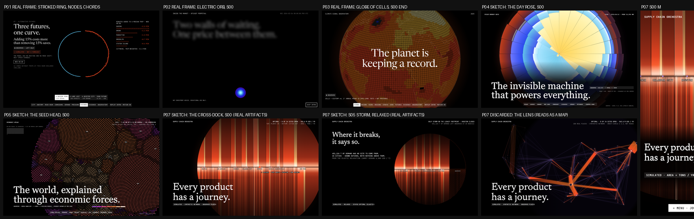
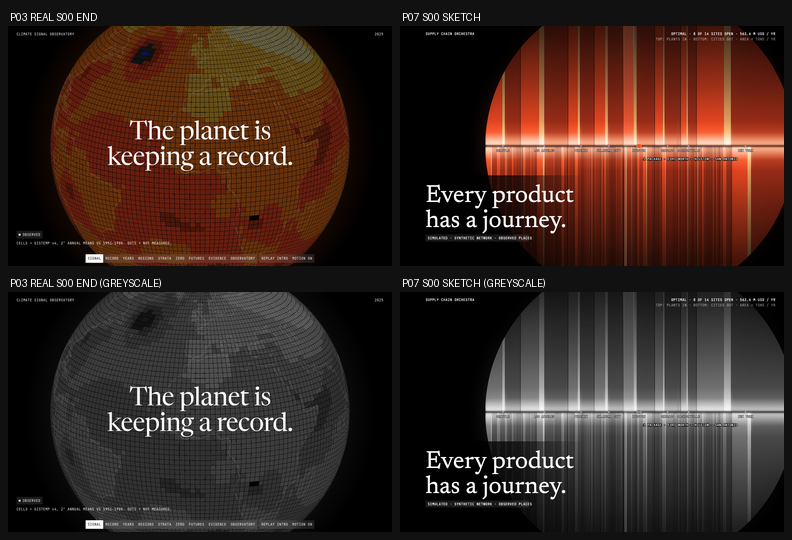

# Visual design: Supply Chain Orchestra ("Every Product Has a Journey")

This document covers phases 14-16: reference research, three competing concepts with a scored
selection, and the experience blueprint. The motion bible (phase 17) is `MOTION_SYSTEM.md`.
Author: Creative Director (task P07-CD-001), 2026-10-11.

## Contents

0. [Binding inputs](#0-binding-inputs)
1. [Reference research (phase 14)](#1-reference-research-phase-14)
2. [Three concepts and the selection (phase 15)](#2-three-concepts-and-the-selection-phase-15)
3. [Experience blueprint (phase 16)](#3-experience-blueprint-phase-16)
4. [Signature interactions](#4-signature-interactions)
5. [Copy deck](#5-copy-deck)
6. [Placeholder bindings and data requests](#6-placeholder-bindings-and-data-requests)
7. [Hard rejection criteria](#7-hard-rejection-criteria)

---

## 0. Binding inputs

These are inputs to the design. The design does not choose them.

- **Shared language.** `design/reference-analysis.md`, `design/interaction-inventory.md`, `shared/design-tokens/tokens.css` and `design/fonts/DECISION.md` (workspace root). Fonts: Newsreader (display) and JetBrains Mono (everything else). The ghost-word state is opacity 0.55 plus a 12px blur (ENGINEERING_DECISIONS #10).
- **What other projects own** (`docs/DESIGN_AUDIT.md`, ENGINEERING_DECISIONS #14, #15, #19, #21, #24, the P01 and P05 VISUAL_DESIGN docs, and MASTER_PLAN for the planned P06, P08-P10). Evidence I opened for this task:
  - P01 `artifacts/evidence/stage-b3/1440x900/06-futures-a-busier.png` (real frame)
  - P02 `artifacts/evidence/stage-a/1440x900/00-s00-t1250.png` (real frame)
  - P03 `artifacts/evidence/stage-a/1440x900/01-s00-t4600-end.png` (real frame; P05's sheet had to use a reconstruction, this one does not)
  - P04 `design/sketches/rose-s00-d.png` and P05 `design/sketches/seed-s00-d.png` (sketches: neither project has evidence frames yet)

  What each project owns:
  - **P01** owns an oversized *stroked* ring with nodes on its circumference, chords inside, a stepping horizon dial, a rising spectral horizon arc as its closing, and **the accent pairing light-blue structure (`#58B8E1`) with orange-red `#FF4C25` as a moving pulse travelling along a chord** (P01 VISUAL_DESIGN lines 43-44).
  - **P02** owns rectilinear depth walls and a smooth Electric glow orb (small, and oversized at S00/S08) that contracts to a marker and grows back.
  - **P03** owns a Solar orb (a flat concentric glow) that resolves into a sphere of square cells with a limb, an equal-area unwrap, a vertical core of strata, and a camera push into the cell surface.
  - **P04** owns a filled, area-true 24-petal rose: wedges, black spokes, radial band fills from the centre.
  - **P05** owns a disc of countable grains on a golden-angle lattice, with seams, sorted core to rim, coalescing and bursting.
  - **Planned:** P06 a radar sweep over concentric rings; P08 concentric population rings; P09 rotating cohort rings and shrinking arcs; P10 a central orb branching into a radial probability field.
- **The plan's P07 identity collides twice.** "An oversized globe-limb arc with nodes travelling its circumference" is P01 (nodes on a circumference) and P03 (globe, limb). "Orange-red packages on a light-blue network" is P01's exact accent pairing *and* its motion grammar (orange travelling along light-blue lines). Both are replaced (section 2, "Departures").
- **Data read on 2026-10-11** from `site/public/data/` (commit `a5c4592`, "Build status: P07 data passed"):
  - **Real anchors.** 100 demand nodes, the largest contiguous-US places by Census PEP 2025 population that join to the Gazetteer 2026 (63,801,512 people, 30.2% of the 211.1 M usable population, `quality.selection`). Population and internal-point coordinates are OBSERVED; nothing else is.
  - **Synthetic network.** 14 candidate sites (S00 New York ... S13 Omaha), 3 plants (P0 Fort Worth, P1 Seattle, P2 Boston), 3 commodities (packaged goods, cold chain, bulky goods), 500 candidate out-arcs (each node to its 5 nearest sites), every plant to every site. Distances are great-circle miles x 1.2 (`network.units.distance`).
  - **Baseline optimum** (`solutions.optimized`): status `Optimal`, objective 563,621,811.62 USD/yr, 8 of 14 sites open (S00, S01, S02, S03, S04, S05, S08, S10), 2,589,781 t/yr in and out, 301 outbound and 27 inbound routes, MIP gap 0, 1 node. Components: fixed 194.7 M, inbound transport 166.4 M, outbound transport 168.8 M, handling 33.7 M.
  - **Legacy footprint** (`solutions.legacy`): the six largest-city sites, 588,008,702.39 USD/yr. Saving 24.4 M (4.15%).
  - **Binding at the optimum:** site capacity S10 Oklahoma City (utilization 1.000, shadow 22.825 USD per throughput unit), plant supply P0 Fort Worth for all three commodities (8.32 / 4.992 / 3.744 USD/t).
  - **Plant supply** totals 3,237,227 t/yr = 1.25 x demand. Demand x1.4 needs 388,466 t more than the plants can make: exactly the relaxation's supply overshoot (`relaxed_supply`).
  - **Hauls** (tons-weighted road-equivalent miles, my computation from routes and `road_mi`, to be published by DR-7): optimized inbound 576.1 / outbound 203.8; legacy 686.2 / 244.0.
  - **Hero journey** (DR-4 rule, my computation): packaged goods made in Fort Worth, held in Houston, delivered to San Antonio, 19,857 t/yr on that path (proportional split at the site), 284.6 + 227.6 road-equivalent miles.
  - **Monte Carlo** (`robustness`): 500 draws, seed 20261012, 163 regional events, up to 4 sites down in a draw, demand multiplier 0.66 to 1.32. Mean service 0.9485 (legacy) vs 0.9812 (optimized); share of draws with full service 0.352 vs 0.638; CVaR95 adjusted cost 1,731 M vs 1,361 M. S00 New York is the most critical single site (+184.7 M USD).
  - **Parity** (`artifacts/evidence/parity_report.json`): 31 vectors, 0 failures, HiGHS-wasm 1.15.3 median 60 ms, max 1,176 ms (the first preset took 898 ms).
- **Contracts.** `docs/DATA_CONTRACTS.md` plus 8 schemas in `data/contracts/`. Section 6 binds every placeholder to those field names. Anything missing is a numbered data request (DR-n).
- **Honesty rules from the data** (binding on every view):
  1. The network, costs, capacities, volumes and every solver or Monte Carlo output are SYNTHETIC; the chip says so wherever a flow, cost or status is shown. Only place population and location are OBSERVED.
  2. Distances are great-circle x 1.2. Lanes are drawn as great-circle paths, never as roads, and the map carries `GREAT-CIRCLE x 1.2 · NOT ROADS`.
  3. **Routes drawn == solution flows.** Every bar on the dock and every ribbon on the map is one published or solved route; nothing is decorative, interpolated or smoothed.
  4. Solver status is always on screen next to any solved number: `OPTIMAL`, `INFEASIBLE`, `TIME LIMIT`, or `RELAXED (ELASTIC)`. The source is always on screen: `SOLVED IN BROWSER · HiGHS` or `PRECOMPUTED · PYTHON HiGHS`.
  5. Infeasibility is explained in words built from the relaxation report (`relaxation.summary`, DR-8), never as a bare "infeasible".
  6. Duals are conditional on the open set and valid for small changes only (`solutions.duals_note`).
  7. Census attribution with no endorsement (`meta.attribution`, `meta.licence_note`) is in the footer of every scene from S01 on.
- **Sketches** (original, rendered from the real artifacts by `design/sketches/render_dock_sketch.py` and `render_lens_sketch.py`, stdlib Python; rasterized by `render_sheet.mjs`, composed by `compose_sheet.py`):
  - `design/sketches/dock-s00-d.png` and `dock-s00-m.png`: the S00 end state, D and M
  - `design/sketches/dock-s05-d.png`: the Gulf storm on the legacy footprint, relaxed (unserved demand)
  - `design/sketches/dock-s00-d-violet.png`: the rejected violet colourway
  - `design/sketches/lens-s00-d.png`, `lens-s00-t0-d.png`, `lens-s04-d.png`, `lens-s00-m.png`: the discarded "Lens" iteration
  - `design/sketches/distinctness-sheet.png`: the contact-scale comparison (section 2)
  - `design/sketches/p03-p07-pair.png`: the P03 watch-item check, colour and greyscale (section 2)
- **What we take from the reference** (principles only, never assets or copy): black stages lit by one luminous form, oversized serif statements revealed word by word through blur, uppercase mono for all UI and body copy, 100dvh sticky stages in long tracks, threshold-stepped 1.2s settles, 4-segment story cards, an argument card stack, a square blur bottom nav with a mobile current-section pill, and a closing that echoes the opening. We do **not** take its ring dial. Our circle has no outline, no marks on its circumference, and never rotates.

### The Cross-Dock: encoding (binding)

The giant circular element is **the Cross-Dock**: one year of freight drawn as a single disc that a horizontal dock line cuts in two. Everything that arrives from the plants is above the line; everything that leaves for the cities is below it. Because the model holds no inventory (`flw[f,k]`: in = out at every site), the two halves are always equal, and the disc is round because it balances.

| Aspect | Rule |
|---|---|
| **Area** | The disc's area is 2 x the tons through the network in the shown state: the top half is inbound tons (plants to sites), the bottom half outbound tons (sites to cities). Tons per px² (`k`) is a constant per viewport, set at G0 by the optimized baseline (2,589,781 t): D `k` = 4.901 t/px² (R 580), T 4.025 (R 640), M 6.339 (R 510). Scene states scale `R` by camera only (3.3), never `k` within a state. A scenario with more tons has a bigger disc: `R = sqrt(2 × tons / (π k))`, so demand x1.4 is R x 1.183 |
| **Dock** | **An absence of light, never a drawn line** (amendment P07-CD-002). A 4px seam through the centre (D 4px, T 4px, M 3px) where no bar is drawn; the bars beside it start at 12% opacity and reach full brightness 1.4% of R away, so the seam reads as light falling away into a slit. A soft inner glow (the bars within 16% of R of the seam, blurred 5px, screen-blended at 75%) lights both edges. The seam is ink, not area: half-areas are computed on the full half-discs. Open sites sit in it as 5px violet `#B48CFF` squares at their column centres; closed candidates as 4px hollow violet squares in longitude order between columns (zero width: no flow, no area). Site names sit 10px below the seam in 11px mono at 70% |
| **Columns** | One column per open site, ordered west to east by site longitude (ties by id). A column's x-range is chosen so that the half-disc area over it equals the site's throughput in tons divided by `k`. The **same x-range** holds above and below the dock, so conservation is visible as mirror symmetry of area |
| **Bars** | Above the dock, a column holds one bar per (plant, commodity) with positive flow, ordered by plant longitude then commodity id. Below, one bar per (city, commodity), ordered by city longitude then commodity id. A bar's x-range (its **slot**) carries its area exactly. **Separators are hairline black gaps, never drawn lines:** the ink is inset 0.25px each side (a 0.5px gap) and 0.8px at column edges (a 1.6px gap). Slots under 2px wide are drawn merged with their neighbour's ink, never dropped. The tooltip and inspector always give the exact tons |
| **Colour** | Commodity, from the SIMULATED orange family (section "Colour semantics"): packaged goods `#FF4C25`, cold chain `#FFB26B`, bulky goods `#A8301A`. **Each bar is a volumetric gradient lit from the dock outward** (offsets from the seam to the rim): 0 tint at 12%; 0.014 tint at 100% (the white-hot inner edge: packaged `#FFB49A`, cold `#FFE6C8`, bulky `#E8805E`); 0.09 commodity colour at 95%; 0.38 at 58%; 0.72 at 26%; rim at 10%. **No bar is ever a flat swatch.** The commodity identity and its 3:1 contrast are read in the 0.014-0.09 band. **Rim bloom (S00 and S08 only):** the bars blurred 38px at 20% under the disc, so a dim halo spills just beyond the rim; never in scene states |
| **Hero** | One orange-red package (a 16px square on D, 12px on M, 1px `#FFE6C8` edge) sits in the seam at the hero site's column. The hero's inbound and outbound bars brighten (a `#FFE6C8` overlay at 10%) with a 1px edge at 45%; no heavy outline. The caption names the path and says how it was chosen (DR-4) |
| **Relaxed states** | **Unmet demand:** an `UNSERVED` column at the east end of the disc. Below the dock, its bars (city, commodity) are drawn in a 45° orange-red hatch (1.4px lines at a 6px pitch) with a 0.8px outline. Above the dock, the column is **empty**: a 1px dashed orange-red edge (3/3) marks the area that nothing arrives to fill. **Supply overshoot:** the overshoot share of each affected (plant, commodity) bar is hatched at its rim end (area-true). **Capacity overshoot:** in an over-capacity column, every bar's rim-end share `so[f] / units_used[f]` is hatched. **Open-site excess:** the dock prints `+{{n}} SITES OVER THE LIMIT` and every open square carries a hatch |
| **Infeasible (strict)** | There is no solution, so there are no bars. The disc area the demand would need is drawn as a 45° white hatch at 12% with no edge line, the dock line stays, and the status reads `INFEASIBLE` with `RELAX TO SEE WHY` |
| **Unit** | Every dock view prints `AREA = TONS / YR · TOP: FROM PLANTS · BOTTOM: TO CITIES` and the commodity legend (three swatches, never a gradient bar) |
| **Labels** | Site names in 11px mono uppercase above the dock, centred on the column, with a 4px black paint-order stroke. On M, only columns at least 44px wide are labelled; tap names any bar |
| **Never** | An outline or outer circle; a ring; guide rings; ticks or marks on the circumference; nodes on any circle; chords; radial lines, wedges, petals or spokes; rotation or any angular encoding; a sweep; dots or grains tiling the disc; square cells; sphere shading or a limb; a smooth glow disc; any curved band from rim to rim. Bar *height* never encodes anything (it is the circle's chord); only bar area does |

**Why a circle, and why the dock.** A supply chain is a balance: what the plants send in, the sites send out. A disc cut through its centre is the one shape whose two halves are equal and mirror each other column by column, so conservation is the geometry itself. When the model cannot balance, the disc visibly cannot either: unmet demand is a notch above the dock with nothing in it, supply overshoot spills out at the rim. The cross-dock is the logistics term for exactly this operation (reference 7): inbound unloaded on one side, sorted, loaded outbound on the other, nothing stored.

**The map.** The Cross-Dock unfolds into a map (S04 onwards; interaction 5). The map is the second view of the same flows, never a different dataset:

| Aspect | Rule |
|---|---|
| Projection | Conic equal-area (Albers), standard parallels 29.5N and 45.5N, origin 37.5N 96W (DR-5). No basemap, no coastline, no state lines, no tiles: the country is implied by 100 white points |
| Cities | White dots, area ∝ population (radius 0.9 + 3.2 x sqrt(pop / 8.6 M) px on D). OBSERVED |
| Sites | Violet squares: outer side ∝ sqrt(capacity), black inside; open sites hold an orange fill whose area is the utilization share (S10 is full). Closed candidates are violet outlines at 35% |
| Plants | Violet diamonds (a square at 45°), 18px on D |
| Candidate arcs | All 500, violet `#B48CFF` at 25%, 0.6px: the options the solver chose from |
| Flows | One ribbon per lane, made of its commodity strands laid side by side (packaged, cold, bulky, from the left of the direction of travel) in the bars' colours, along the great-circle path sampled at 24 points; total width ∝ tons: D 1px per 20,000 t/yr (the largest inbound lane, Boston to New York, 706,653 t, is 35px), T 1 per 26,000, M 1 per 40,000. Under 0.6px, ink is 0.6px with opacity scaled to keep area. A lengthwise gradient (45% at the origin, 100% at the destination) gives direction without arrows. A site in the same place as its city ("delivered in place", 0 mi) shows only in the site's fill and the inspector |
| Never | Bowed Bézier arcs, 3D arcs, arrowheads, a basemap, glow trails, travelling dots or pulses along lanes (P01's grammar), a heat map |

### Colour semantics (project 07 rule set): colour is provenance

P07 is the program's synthetic-network site, so its palette is its honesty legend. Every colour on a data mark is the colour of that mark's tag.

| Role | Value | Contrast on `#000` | Rule |
|---|---|---|---|
| OBSERVED places (points, names, populations) | `#FFFFFF` (`--tag-observed`) | 21 | The only white data marks on the site |
| SYNTHETIC structure: sites, plants, candidate arcs, dock squares | `#B48CFF` (`--tag-synthetic`) | 7.9 | Lines, outlines, small squares and text. The network is drawn in the colour that says "invented" |
| SYNTHETIC active control blocks, the violet story card | `#690DE2` fill only | 2.8 | White text on it (7.6:1). **Never** a line, text or data mark |
| SIMULATED solver flows: packaged goods | `#FF4C25` (`--tag-simulated`) | 6.3 | Bars, ribbons, the hero package, the SIMULATED chip |
| SIMULATED flows: cold chain | `#FFB26B` | 11.8 | |
| SIMULATED flows: bulky goods | `#A8301A` | 3.1 | Fill only (graphics 3:1 at the dock end); never text |
| Relaxation slack (RELAXED) | 45° `#FF4C25` hatch, 1.4px at 6px pitch | 6.3 | Unmet demand, overshoots. Never a solid fill: slack is not a flow |
| DERIVED: distances, shadow prices, demand prices, average hauls | `#58B8E1` (`--tag-derived`) | 9.4 | **Readouts, brackets and chips only. Never a lane, ribbon or network line** (that is P01's structure colour) |
| Status | `OPTIMAL` `--state-success` `#6BE38A`; `INFEASIBLE` `--state-error` `#FF6A4D`; `TIME LIMIT` `--state-warning` `#FFB547` | ≥ 7 | The status word only, in 13px mono, beside a SIMULATED chip |
| Text | `#fff`, and `rgba(255,255,255,.5)` at 13px and up | | Flow colours are never body text |

- **Accent decision (the plan said "orange-red packages on a light-blue network").** Orange-red packages are **kept**, but as something P01's orange never is: settled, area-true fills (bars, ribbons, one hero package) that never travel as a stream of dots. The network moves from light blue to **SYNTHETIC violet**, because P01 owns light-blue structure with travelling orange. Light blue survives only as DERIVED readouts. On the distinctness sheet P07 reads as a warm, vertically barred disc with a black horizontal cut, and P01 as a thin blue-and-orange ring (section 2).
- **Rejected colourway.** An all-violet dock (`dock-s00-d-violet.png`) was rendered and rejected: violet as the luminous mass would collide with P10's Electric violet (planned) and P08's purple, and it would break "colour is provenance" (flows are SIMULATED, not SYNTHETIC structure).
- The three commodity colours differ in luminance (3.1, 6.3, 11.8), so commodity survives greyscale and colour-vision deficiency; the legend also names them, and the inspector gives tons per commodity.

### Uncertainty and honesty grammar

| Kind | Tag (chip text from the artifact, DR-3) | Visual |
|---|---|---|
| Place population and location | OBSERVED | White points and names |
| Road-equivalent distance, hauls, duals, demand prices | DERIVED | `#58B8E1` readouts with `GREAT-CIRCLE x 1.2` or `CONDITIONAL ON THE OPEN SET` |
| Network, sites, plants, capacities, costs, volumes | SYNTHETIC | Violet structure; every cost number carries `SYNTHETIC COSTS` |
| Solver flows, objective, open set, status | SIMULATED (on a SYNTHETIC network) | Orange bars and ribbons; the status word and the source (`SOLVED IN BROWSER · HiGHS` or `PRECOMPUTED · PYTHON HiGHS`) beside every solved number |
| Relaxation slack | SIMULATED · RELAXED | Hatch, never solid; the words of DR-8 always beside it |
| Monte Carlo draws and summaries | SYNTHETIC/SIMULATED | As artifact; every MC number carries `500 SEEDED DRAWS` |
| PREDICTED | Never | Nothing on this site is a forecast |

Every visual carries one chip: 13px mono, 8px padding, `#ffffff1a` background, the text in the tag's colour. Where an artifact carries `tags`, **the chip text comes from the artifact**, not from this document (DR-3 aligns the artifact tags with the brief: solver outputs SIMULATED).

**The footer is on every scene from S01 on** (12px mono, 50% white): `meta.attribution`, `meta.licence_note` (S02 card 1, S07 answer 7 and S08), `SEED {{meta.seed}}`, and `meta.limitations[0]` verbatim, uppercased ("THE NETWORK, COSTS AND CAPACITIES ARE SYNTHETIC; RESULTS ARE NOT STATEMENTS ABOUT ANY REAL SUPPLY CHAIN."). No paraphrase of an artifact string is ever bound to that artifact's field; design copy is marked as such in section 5.

---

## 1. Reference research (phase 14)

Each reference was verified on 2026-10-11 by one of these methods:

- **C:** `curl -L` (desktop UA) returned HTTP 200, and the page title was read (quoted).
- **R:** the orchestrator's captured reference walk (`design/reference/`).
- **F:** a fact read from a file in this repository.

**The Motion column describes, it does not observe.** Unless the row is marked R, I did not watch the motion in a browser for this task, and the design does not claim it as an observed interaction.

Excluded after checking (not cited):

| URL | Result |
|---|---|
| nytimes.com interactive, "supply chain crisis" (2021) | 403 |
| w3.org WCAG 2.1 "Understanding Non-text Contrast" | 403 (bot check) on this run; the 3:1 graphics rule is applied from the shared tokens' contrast notes instead |
| bts.gov/faf | 403 Access Denied (also recorded in `docs/DATA_SOURCES.md`) |
| gurobi.com feasRelax reference page | Redirected to the manual's root (`docs.gurobi.com/projects/optimizer/en/current/`); the page about elastic relaxation was not reached |
| en.wikipedia.org "Fixed-charge transportation problem" | 404 |
| blink.capital page title | HTTP 200 but the HTML sets no `<title>`; cited as R through the captured walk |

| # | Reference (URL) | Verified | Technique | Motion (described, not observed, unless R) | Strength for us | Implementation direction | Originality strategy |
|---|---|---|---|---|---|---|---|
| 1 | Blink Capital, https://blink.capital/ | R | 100dvh sticky stages, story cards, chat stack, blur bottom nav, one luminous form | Observed: 1.2s `cubic-bezier(.33,1,.68,1)` stepped settles, word blur reveal, instant nav jumps | The mandatory grammar | Principles only, through the shared shell and tokens | Our luminous form is a disc cut by a dock line, lit from that line outward. No ring, no dial, no rotation, no outline |
| 2 | U.S. Census Bureau, Gazetteer Files, https://www.census.gov/geographies/reference-files/time-series/geo/gazetteer-files.html | C ("Gazetteer Files") | The internal-point coordinates | n/a | The only OBSERVED location | Map points; S02 card 1 says "internal point, not a city hall or a warehouse" | We show the internal-point caveat on screen, not in small print |
| 3 | U.S. Census Bureau, City and Town Population Totals, https://www.census.gov/data/tables/time-series/demo/popest/2020s-total-cities-and-towns.html | C ("City and Town Population Totals: 2020-2025") | The PEP vintage 2025 populations | n/a | The only OBSERVED quantity | City point area; S02 card 1 join ledger | The join ledger as a card visual: 32,363 rows to 100 places, every drop counted |
| 4 | HiGHS documentation, https://ergo-code.github.io/HiGHS/dev/ | C ("About · HiGHS Documentation") | The MILP solver, its status strings, LP file format | n/a | The engine on both sides of the parity | The LAB status vocabulary and the worker contract | We show the solver's own status words, never a softened version |
| 5 | lovasoa, highs-js, https://github.com/lovasoa/highs-js | C ("GitHub - lovasoa/highs-js: Javascript linear programming library · GitHub") | HiGHS compiled to WebAssembly | n/a | The browser solve | A module worker, lazy at S03b, highs@1.15.3 (ED #21) | Same LP text in both builders; the browser proves its own hash on the page |
| 6 | Wikipedia, "Facility location problem", https://en.wikipedia.org/wiki/Facility_location_problem | C ("Facility location problem - Wikipedia") | The model family | n/a | Vocabulary: fixed cost against distance | S03a framing | Shown as columns opening on the dock, never as service circles on a map |
| 7 | Wikipedia, "Cross-docking", https://en.wikipedia.org/wiki/Cross-docking | C ("Cross-docking - Wikipedia") | Inbound unloaded, sorted and loaded outbound with little or no storage | n/a | The metaphor of the giant element, and literally the model's no-inventory rule | The dock line and the two halves | The whole country's year of freight as one cross-dock |
| 8 | Wikipedia, "Flow network", https://en.wikipedia.org/wiki/Flow_network | C ("Flow network - Wikipedia"; the "Flow_conservation" title redirects here) | Capacity and conservation constraints | n/a | Why the halves are equal | The column rule (same x-range above and below) | Conservation as mirror symmetry of area |
| 9 | Wikipedia, "Shadow price", https://en.wikipedia.org/wiki/Shadow_price | C ("Shadow price - Wikipedia") | The marginal value of relaxing a constraint | n/a | S03b's question: what is a full site worth? | DERIVED readouts in light blue, verified live (interaction 3) | The dual is tested against a real re-solve on the page |
| 10 | Wikipedia, "Duality (optimization)", https://en.wikipedia.org/wiki/Duality_(optimization) | C ("Duality (optimization) - Wikipedia") | Duals, strong duality | n/a | S07 answer on why duals are conditional | Copy only | n/a |
| 11 | Wikipedia, "Linear programming relaxation", https://en.wikipedia.org/wiki/Linear_programming_relaxation | C ("Linear programming relaxation - Wikipedia") | The LP bound under a MILP | n/a | The 0.28% LP gap fact | S02 card 4 and S07 | n/a |
| 12 | Wikipedia, "Penalty method", https://en.wikipedia.org/wiki/Penalty_method | C ("Penalty method - Wikipedia") | Penalising constraint violation instead of forbidding it | n/a | The elastic relaxation, in plain terms | S05 copy: penalties are devices, not costs | The violation is drawn as hatch at the place it happens |
| 13 | Wikipedia, "Isotype (picture language)", https://en.wikipedia.org/wiki/Isotype_(picture_language) | C ("Isotype (picture language) - Wikipedia") | Countable units | n/a | The honest way to say "one package" | The hero package is one counted thing, named and sourced | One package, not a stream of icons; area carries the tons |
| 14 | Wikipedia, "Barcode", https://en.wikipedia.org/wiki/Barcode | C ("Barcode - Wikipedia") | Information as parallel bars of varying width | n/a | The vernacular of every parcel | The dock's bar texture reads as "a label" at a glance | Our bar widths are tons, and the bars sit inside a circle, not a label |
| 15 | Wikipedia, "Sankey diagram", https://en.wikipedia.org/wiki/Sankey_diagram | C ("Sankey diagram - Wikipedia") | Flow quantities as band widths between stages | Bands sliding (described) | **Anti-reference.** The default form for two-echelon flows | Rejection criterion 2: no curved bands from rim to rim, no stage columns | The dock keeps flows as straight vertical slots in one disc |
| 16 | Wikipedia, "Mosaic plot", https://en.wikipedia.org/wiki/Mosaic_plot | C ("Mosaic plot - Wikipedia") | Area partitioned by nested categories | n/a | **Anti-reference.** The nested-rectangle chart the dock could slide toward | No rectangles, no axes, no proportion labels on the edges | Partition inside a circle, cut by a dock, lit from the dock |
| 17 | Wikipedia, "Flow map", https://en.wikipedia.org/wiki/Flow_map | C ("Flow map - Wikipedia") | Lines of width ∝ quantity on a map | n/a | The honest map form: width = tons | The S04+ map ribbons | Straight great-circle ribbons on a map with no basemap, born from the dock's bars |
| 18 | deck.gl, ArcLayer, https://deck.gl/docs/api-reference/layers/arc-layer | C ("ArcLayer \| deck.gl") | Bowed 3D arcs between points | Described | **Anti-reference: the generic logistics map.** Glowing bowed arcs over a dark basemap | Rejection criterion 3 | Our lanes are great-circle paths with width ∝ tons, flat, no glow, no basemap |
| 19 | kepler.gl, "Arc", https://docs.kepler.gl/docs/user-guides/c-types-of-layers/b-arc | C ("Arc \| kepler.gl") | The same arc layer in a product UI | Described | **Anti-reference** (the same cliché in its tool form) | As 18 | As 18 |
| 20 | FlowmapBlue, https://www.flowmap.blue/ | C ("FlowmapBlue – Flow map visualization tool") | Origin-destination flow maps with animated particles | Particles along flows (described) | **Anti-reference** for motion: particles along lanes are P01's pulse grammar and a generic look | Rejection criterion 3: no travelling dots on lanes | One package travels only in the Journey (interaction 9), one at a time |
| 21 | Wikipedia, "Great-circle distance", https://en.wikipedia.org/wiki/Great-circle_distance | C ("Great-circle distance - Wikipedia") | Haversine distance | n/a | The basis of every mile | `GREAT-CIRCLE x 1.2 · NOT ROADS` on every map and readout | Lanes drawn as true great-circle paths, never smoothed into roads |
| 22 | Wikipedia, "Albers projection", https://en.wikipedia.org/wiki/Albers_projection | C ("Albers projection - Wikipedia") | Conic equal-area | n/a | Area-honest US map for the unfold | DR-5 constants | n/a |
| 23 | D3, "Conic projections", https://d3js.org/d3-geo/conic | C ("Conic projections \| D3 by Observable") | `geoAlbers` parallels 29.5/45.5 | n/a | The same constants, cross-checked | A 20-line projection in TS with Vitest parity against DR-5; no d3-geo dependency | n/a |
| 24 | Wikipedia, "Expected shortfall", https://en.wikipedia.org/wiki/Expected_shortfall | C ("Expected shortfall - Wikipedia") | CVaR | n/a | S06's tail number | The CVaR readout and its "worst 25 of 500 draws" note | n/a |
| 25 | Wikipedia, "Variance reduction", https://en.wikipedia.org/wiki/Variance_reduction | C ("Variance reduction - Wikipedia") | Common random numbers | n/a | Why legacy and optimized face the same 500 storms | S06 pairs the two discs draw by draw | n/a |
| 26 | Wikipedia, "Monte Carlo method", https://en.wikipedia.org/wiki/Monte_Carlo_method | C ("Monte Carlo method - Wikipedia") | Seeded random sampling | n/a | S06 vocabulary | `500 SEEDED DRAWS · SEED 20261012` | n/a |
| 27 | Google OR-Tools, MIP, https://developers.google.com/optimization/mip | C ("OR-Tools \| Google for Developers") | The plan's named Python solver family | n/a | Context for the plan's departure | Copy: the reference solve is HiGHS (highspy), not OR-Tools | n/a |
| 28 | Wikipedia, "Supply chain", https://en.wikipedia.org/wiki/Supply_chain | C ("Supply chain - Wikipedia") | The domain | n/a | Reader vocabulary | S01 | n/a |
| 29 | MDN, CanvasRenderingContext2D, https://developer.mozilla.org/en-US/docs/Web/API/CanvasRenderingContext2D | C ("CanvasRenderingContext2D - Web APIs \| MDN") | 2D paths, clipping, patterns | n/a | Renderer for about 330 bars, their ribbons and 500 arcs | MOTION_SYSTEM 9.1 | n/a |
| 30 | MDN, "Using Web Workers", https://developer.mozilla.org/en-US/docs/Web/API/Web_Workers_API/Using_web_workers | C ("Using Web Workers - Web APIs \| MDN") | Off-main-thread work | n/a | The solve never blocks scroll | The HiGHS worker | n/a |
| 31 | Lenis, https://lenis.darkroom.engineering/ | C ("Lenis – Smooth Scroll") | Normalized smooth scroll | Inertial scroll | The reference's own smoothing | The shared shell's one progress loop | n/a |
| 32 | The Pudding, "Human Terrain", https://pudding.cool/2018/10/city_3d/ | C ("Human Terrain") | Population made physical | Scroll-driven camera (described) | Matter as data | The disc as one physical year of freight | No 3D, no terrain |
| 33 | Igloo Inc (Awwwards SOTD), https://www.awwwards.com/sites/igloo-inc | C ("Igloo Inc - Awwwards SOTD") | A cinematic intro that hands off to scroll | Described | Intro pacing | The 4.6s skippable "dock opens", whose end state is S01's start | Our intro is a flow balance being loaded, not a camera flight |
| 34 | Active Theory V6 (Awwwards SOTD), https://www.awwwards.com/sites/active-theory-v6 | C ("Active Theory V6 - Awwwards SOTD") | One dominant form carrying a site | Described | One form across every scene | The dock carries S00 to S08 | Data-bound bars, Canvas2D, no 3D |
| 35 | Wikipedia, "Synthwave", https://en.wikipedia.org/wiki/Synthwave | C ("Synthwave - Wikipedia") | The genre whose striped sunset sun is a known visual cliché | n/a | **Anti-reference** for the hero: a warm disc cut by *horizontal* stripes over a horizon | Rejection criterion 2: stripes are only vertical, no horizon gradient below the disc, no grid floor | Our stripes are data slots and vertical; the only horizontal is the dock |
| 36 | Census Bureau Data API terms (via `docs/DATA_SOURCES.md`) | F | Attribution and no endorsement | n/a | Legal wording | Footer on every scene | n/a |
| 37 | `artifacts/evidence/parity_report.json` | F | 31 vectors, 0 failures, median 60 ms | n/a | The browser can solve on the page | S07 answer 4 and the LAB status | The page re-proves the hash itself at S03b entry |

---

## 2. Three concepts and the selection (phase 15)

All three use the shared family:

- black stages, Newsreader statements, mono UI
- sticky stages in tracks
- story cards and an argument stack
- the bottom blur nav and a closing echo

What differs is the metaphor, the giant circular composition, the scene composition and the closing.

**The distinctness constraint I designed against:**

| Project | Owns (do not touch) |
|---|---|
| P01 | A 164vw **stroked** ring with nodes on its circumference, chords inside, stepping as a horizon dial; a rising spectral horizon closing; **light-blue structure with travelling orange pulses** |
| P02 | Rectilinear depth walls; a smooth **Electric glow orb**, small and oversized, contracting to a marker and growing back |
| P03 | A **Solar glow orb** resolving into a **sphere of square cells** with a limb; the equal-area unwrap; a vertical core of strata; a camera push |
| P04 | A **filled, area-true 24-petal rose**: wedges, black spokes, radial band fills |
| P05 | A **disc of countable grains** on a golden-angle lattice, territories with seams, coalesce and burst |
| Planned P06, P08-P10 | Radar sweep over concentric rings (P06); concentric population rings (P08); rotating cohort rings and shrinking arcs (P09); a central orb branching into a radial field (P10) |

Nearly every radial or circumferential structure is owned. What is left is a circular **boundary** with **non-radial** internal structure, whose area is tied to a real conserved quantity. The test applied to every tile: would a stranger reach for ring, dot, orb, globe, petal, wedge, grain, spiral, radar or arc?

**One development iteration** was rendered from real data and discarded (the PNGs are kept as evidence):

1. **"The Lens"** (`lens-s00-d.png`, `lens-s00-t0-d.png`, `lens-s04-d.png`, `lens-s00-m.png`): a giant magic lens over the solved network map, lit inside, dim outside, with the hero package magnified at S00. Rendered at the D G0 geometry from the real routes, it **failed on both counts**: the circle was nearly invisible (a lens is defined by what it crops, and the network is sparse at its rim), and the frame read as exactly the generic logistics map of references 18-20. Its lesson is now rejection criterion 3, and its one good idea (a comparison through a boundary) survives as the S04 dock-to-dock re-partition.

### Concept A: "The Cross-Dock"

- **Philosophy.** Every product's journey has two legs, in and out, and the model holds nothing in between. Draw one year of freight as a disc cut by a dock: everything that arrives above, everything that leaves below, each site a column, each route a bar whose area is its tons. The circle is round because the network balances. Open a site and a column splits; close one and its bars move to its neighbours; break a constraint and the disc shows where it cannot balance.
- **Signature geometry.** The Cross-Dock (section 0), plus one companion: the **map**, where every bar unfolds into its own ribbon along a great-circle path.
- **Accent use.** Commodity colours from the SIMULATED orange family; SYNTHETIC violet structure; DERIVED light-blue readouts only; white OBSERVED places.
- **Layout.** Asymmetric editorial: statements in a left column, the disc centre-right.
  - S00 and S08: giant and cropped (left arc visible on D).
  - S03a, S03b and S05: the disc at scene size, with ledgers on the left.
  - S04: the disc unfolds into the map across the right two-thirds.
  - S06: two discs side by side (legacy, optimized) facing the same draw.
  - LAB: the disc and the map side by side, controls on a glass rail.
- **3D/2D strategy.** Canvas2D for the disc, the map and the unfold (about 330 bars, 330 ribbon strands and 500 candidate arcs, cached as `Path2D` at rest). DOM for all text and controls. No WebGL. HiGHS-wasm in a module worker.
- **Hero concept.** Black. A single orange package on a thin dock line that spans the frame. The dock opens: bars rise above it (the plants' deliveries) and fall below it (the cities' orders), until a giant disc stands, cropped by the frame, lit from the line. "Every product has a journey."
- **Nav labels.** JOURNEY · WHAT IS REAL · SITES · LIMITS · UNFOLD · BREAK IT · STORMS · EVIDENCE · THE DESK
- **Motion character.** Bars only ever move along the dock (columns re-partition horizontally) or out of it (into ribbons). Nothing rotates, nothing travels around the circle, and no dot streams along a lane. Loading and unloading are vertical; re-solving is lateral; unfolding is a flight.
- **Responsive approach.** D: disc centre-right. T: disc lower right with the edge arc visible bottom-right. M: disc at the top with the bottom arc above the MENU pill; only the columns near the centre are in frame, and a horizontal swipe on the dock pans the camera (never the page). Geometry always comes from `k`, `c` and the solution, never from scaling a bitmap.

### Concept B: "The Lens"

- **Philosophy.** The network is a map you inspect through a giant magic lens: outside it, the reference scenario, dim; inside it, the scenario under test, lit. The lens goes where the solver says something changed.
- **Signature geometry.** A giant circular aperture (no outline) over a full-frame network map; magnification only in S00 (a package magnified x24 at the start) and in the inspector.
- **Hero concept.** One package magnified inside the lens, the lens pulling back until the national network fills it.
- **Nav labels.** PACKAGE · SOURCES · SITES · LIMITS · COMPARE · BREAK IT · STORMS · EVIDENCE · THE DESK
- **Strength.** Honest geography: distances are the real great-circle lines; comparisons are visible as lanes that end at the rim.
- **Weaknesses** (measured on the rendered sketch, not guessed):
  - The circle is defined only by what it crops, so with a sparse western network it barely exists at contact scale.
  - The base image is a lane map with glowing lines: references 18-20, the generic logistics map.
  - Packages streaming along lanes would be P01's travelling orange on lines.

### Concept C: "The Vessel"

- **Philosophy.** The plants can make 3,237,227 t a year; the country wants 2,589,781 t. Draw the plants' supply as a giant round vessel and the demand as the light it holds: 80% full. Raise demand by 40% and the light overflows the rim by exactly the 388,466 t the relaxation reports.
- **Signature geometry.** A giant disc whose area is plant supply, filled from the bottom by a luminous body whose area is demand, with a flat meniscus.
- **Hero concept.** The vessel filling to its line.
- **Nav labels.** VESSEL · SOURCES · SITES · LIMITS · FLOWS · OVERFLOW · STORMS · EVIDENCE · THE DESK
- **Strength.** The single clearest picture of a supply shortfall in the program; the overflow equals the slack exactly.
- **Weaknesses.**
  - It encodes one or two scalars; sites, lanes and cities have nowhere to live, so every other scene needs a different visual.
  - A liquid fill in a circle is a dashboard gauge (a standard chart), and its meniscus is a horizon line across a giant circle (P01 territory).
  - Only plant supply has a natural rim; capacity and the open-site limit do not.

### Scores (1 = poor, 5 = excellent)

| Criterion | A The Cross-Dock | B The Lens | C The Vessel |
|---|---|---|---|
| Fidelity to the reference language (one luminous form, statements, cards, stack, stepped settles, closing echo) | 5 | 3 | 4 |
| Analytical clarity (open set, flows, binding constraints, infeasibility, disruption, comparison all legible) | 5 | 4 | 2 |
| **Distinct from P01-P05** (and the planned P06, P08-P10), checked on the contact sheet with real frames | 5 | 2 | 3 |
| **Never reads as a standard chart or a generic logistics map** | 4 | 1 | 2 |
| Accent distinct from P01 (light-blue structure, travelling orange) | 5 | 2 | 4 |
| Feasibility on static Pages (Lighthouse 90+, 60fps D / 30fps M) | 5 | 4 | 5 |
| Data honesty (area = tons exactly, routes drawn == flows, status always shown, slack as hatch) | 5 | 4 | 4 |
| Mobile quality | 4 | 3 | 4 |
| Memorability | 5 | 3 | 4 |
| **Total (of 45)** | **43** | **26** | **32** |

**Why A gets 5 for distinctness.** Checked against every owner at contact-sheet scale (240px-tall tiles, ENGINEERING_DECISIONS #17) in `design/sketches/distinctness-sheet.png`. That sheet holds **real frames** for P01, P02 and P03, the P04 and P05 S00 sketches, the P07 S00 (D and M) and S05 sketches rendered from the real artifacts, and the discarded Lens.

1. **Not P01.** P01 is a thin stroked ring, hollow, with blue and orange halves and chords. A has no stroke and no hollow: it is a filled disc whose only structure is vertical bars and one horizontal black cut. No marks sit on its circumference; sites sit on a straight line.
2. **Not P02.** P02 is a small, smooth blue glow. A is giant from its first full frame, warm, and broken into hard-edged bars; it never contracts to a marker.
3. **Not P03.** P03 is a sphere with a lat-long grid of square cells, coastlines and a limb. A is flat, has no cells, no grid in two directions, no shading toward the rim other than a uniform falloff along each bar, and no coastline. Hue overlaps (both warm), structure does not; this is the one watch item (below).
4. **Not P04.** P04 is wedges and spokes from a centre. A has nothing radial: every edge is vertical or the one horizontal dock.
5. **Not P05.** P05 is a dotted texture of grains with seams. A has no dots at all.
6. **Planned owners.** No concentric rings (P06, P08, P09), no sweep (P06), no arc (P09), no central orb or branching (P10): the disc has no centre mark, and the dock is a line, not a point.

**The P03 check (closed at design time).** P03 and P07 are both warm discs at S00, so I put the real P03 S00 end frame next to the P07 S00 sketch at 240px, in colour and in greyscale (`design/sketches/p03-p07-pair.png`, from `compose_p03_pair.py`; rebuilt after amendment P07-CD-002 with the dock-lit rendering). With hue removed, P03 reads as a sphere wrapped in a curved two-way grid with coastlines, and P07 as a flat disc of vertical bars cut by one black horizontal line. They separate on structure alone, so no mitigation is applied. The QA open/close sheet repeats this check on real build frames (MOTION_SYSTEM test 15).

**Why A gets 4, not 5, for "never a standard chart".** Bars of varying width inside a shape can slide toward a mosaic plot (reference 16) or a "circular barcode" infographic. Section 7 fences it: no axes, no proportion labels on the edge, no rectangles outside the disc, the dock always present, and the disc always lit from the dock.

**Why A gets 4 for mobile.** At M the disc is 2.6 x the frame width, so only 3-5 columns are in view at once (`dock-s00-m.png`). The bottom arc keeps the circle legible, and the camera pans along the dock (interaction 9), but naming relies on tap. That is the main M risk.

### Selection: A, "The Cross-Dock", with two grafts

A is the only concept where the analytical objects *are* the giant geometry: the open set is the columns, the flows are the bars, conservation is the symmetry, and every relaxation has a place on the disc.

- **From C, "overflow is slack".** The vessel's best idea survives exactly: under supply overshoot, the overshoot share of each plant bar is hatched at the rim end, and under unmet demand the `UNSERVED` column has nothing above the dock. The area of the hatch equals the slack the relaxation reports (DR-8 words beside it).
- **From B, "compare through a boundary".** The lens is gone, but its comparison survives in S04 and the LAB as a **re-partition**: the dock of state A re-flows into the dock of state B (keyed by route), and the bars that changed carry a 1px white outline for 2s after landing. On the map, the same changed lanes keep the outline.

**Departures from MASTER_PLAN.**

- "An oversized globe-limb arc with nodes travelling its circumference" is replaced by the Cross-Dock (P01 and P03 own those forms).
- "Orange-red packages on a light-blue network" keeps orange-red packages (as settled, area-true flows and one hero package) and moves the network to SYNTHETIC violet (P01 owns light-blue structure with travelling orange).
- "A single package expanding into arcs and a global network" is kept as **one package on the dock line, then the dock opens**, and later **the dock unfolds into the map**. There are no arcs (references 18-19) and the network is national, not global.
- "Flattens into the solved network map" is kept as the S04 unfold.
- "Baseline vs optimized vs disrupted" is kept (S04, S06).
- The Python reference solver is HiGHS (highspy), not OR-Tools; the page says so (data phase decision, `docs/METHODOLOGY.md`).

---

## 3. Experience blueprint (phase 16)

### 3.1 Chapter-to-scene map

| Scene | Directive chapter | Nav label | Track | Kind |
|---|---|---|---|---|
| S00 Opening | One package (intro) | (none, overlay) | 0 (fixed overlay, 4.6s or less) | Timed intro, skippable |
| S01 Big Idea | Two decisions | JOURNEY | 200vh | Scrubbed blur reveal; the disc moves aside |
| S02 Origin of the Data | What is real, what is invented | WHAT IS REAL | 300vh | Story-card deck |
| S03a Mechanism I | Open a site, shorten a trip | SITES | 300vh | 12 stepped site counts (exactly k = 3..14 open), one real solve each |
| S03b Mechanism II | What binds | LIMITS | 250vh | 3 stepped constraints; the first live solve |
| S04 Transformation | Legacy to optimized, unfolded | UNFOLD | 300vh | Re-partition, then the dock unfolds into the map |
| S05 Experiment | Break it, and hear why | BREAK IT | 300vh (stage pinned until 1) | 3 strict/relaxed pairs, then the storm |
| S06 Consequences | Five hundred storms | STORMS | 300vh | Two discs, 500 paired draws, lose-one-site |
| S07 Evidence | How we know | EVIDENCE | 250vh | Argument card stack, 7 exchanges |
| THE DESK | The orchestra's desk (free solver) | THE DESK | 100dvh minimum, **not pinned**, normal flow | Free exploration with live HiGHS |
| S08 Conclusion | Every product, again (echoes S00) | (none; the nav keeps THE DESK active) | 200vh | The dock closes and reopens on the visitor's network |

The total is about 2,400vh. If the QA scroll recording shows fatigue, cut S03a to 250vh first (fewer k steps: 3, 4, 5, 6, 8, 10, 14), then S02 to 250vh.

### 3.2 Global layout constants

- **Viewports:** D = 1440x900, T = 768x1024, M = 390x844.
- **Grid:**
  - D: 12 columns, 96px side margins, text column x 96-560.
  - T: 8 columns, 48px margins.
  - M: 4 columns, 16px margins.
- **Nav:** a bottom bar 12px from the bottom on D. On T/M, a 160x32 MENU pill at the bottom centre, plus SKIP INTRO / REPLAY at the bottom right.
- **Safe zone:** nothing interactive within 64px of the bottom on D, or 72px on T/M.
- **One Canvas2D stage** (fixed, viewport-sized, DPR-capped) draws the disc, the map and the unfold. Two glow canvases at 1/4 resolution, both static (redrawn only after an opening or re-partition settles, never per frame): the **seam glow** (every scene with a disc: the bars within 16% of R of the dock, CSS `filter: blur(5px)` scaled to 1/4 res, `mix-blend-mode: screen`, 75%) and the **rim bloom** (S00 and S08 only: all bars, blur 38px, 20%, under the disc). Both follow the bars, so neither reads as a smooth disc.
- **The DOM** holds all text, controls, the ledgers, the dock labels (absolutely positioned spans, re-placed on camera change) and the status line.
- **Solver:** a module worker owns HiGHS-wasm (highs@1.15.3). It is created at S03b entry (or on a direct LAB deep link) and never on the LCP path.

### 3.3 Geometry states (exact)

`c` = disc centre in CSS px. `R` = disc radius for the optimized baseline (2,589,781 t). Another solution's radius is `R × sqrt(tons / 2,589,781)` (DR-1 and presets) because `k` is constant within a viewport (section 0).

| State | D 1440x900 | T 768x1024 | M 390x844 | Notes |
|---|---|---|---|---|
| **G0 Giant** (S00, S01 start, S08 echo) | c (900, 450), **R 580** (diameter 1.29 x frame height). The left edge arc is visible from x 320; top, bottom and right are cropped | c (300, 400), R 640 (1.25 x). The edge arc is visible in the bottom-right quadrant from (768, 836) to about (440, 1024), right of the headline scrim | c (195, 270), R 510 (1.21 x). The bottom edge arc is visible across the frame at y 741-780, between the headline band and the MENU pill | **Disc diameter at least 1.2 x the frame height on every viewport, and part of the edge visible outside every scrim.** On M, the dock is at y 270 and the columns S04 to S05 are in frame (sketch `dock-s00-m.png`) |
| G1 Aside (S01 end, S02 backdrop at 20%) | c (1060, 450), R 330 | c (384, 720), R 260 | c (195, 640), R 180 | |
| G2 Scene (S03a, S03b, S05) | c (1010, 470), R 360 | c (384, 640), R 300 | c (195, 420), R 190 | Scenario discs scale by `sqrt(tons)`: the S05 demand x1.4 disc is R 426 on D |
| MAP (S04 after the unfold, LAB right panel) | Network bbox fitted to x 560-1380, y 130-740 | x 32-736, y 400-880 | x 8-382, y 260-560 | Albers (DR-5). Ribbon scales in section 0 |
| G4 Pair (S06) | Two discs: legacy c (760, 470), optimized c (1150, 470), R 200 each at baseline tons | c (210, 640) and (558, 640), R 160 | Stacked: c (195, 300) and (195, 600), R 130 | Each draw's disc scales by `sqrt(draw tons)` (DR-6) |
| G5 Desk (THE DESK) | Disc c (430, 520), R 300; map x 800-1400, y 160-760 | Disc c (384, 360), R 260; map under it, y 640-1000 | Disc c (195, 300), R 170; map under it | |

- **Interpolation.** Between states, `c` interpolates linearly and `R` in **log space**. These are camera moves on the whole disc; they never animate data.
- **Mobile pan.** On M (and T in the LAB), a horizontal drag that starts on the dock band (±24px) pans the camera along x within the disc's extent. Vertical drags always scroll the page (MOTION_SYSTEM test 12). A `◀ ▶` pair of 44px squares at the dock ends does the same for keyboard and switch users.
- **Arithmetic check.** `k = 2 × 2,589,781 / (π R²)`: R 580 gives 4.901 t/px², R 640 gives 4.025, R 510 gives 6.339. The smallest route (821 t) is a slot of 168 px² at G0 D, about 0.3px wide at the centre: merged ink, exact area.
- **Sketches.** `dock-s00-d.png` (R 580) and `dock-s00-m.png` (R 510, bottom arc visible above the MENU pill) were rendered at these values. `dock-s05-d.png` uses R 330 to show the full disc in one frame; the build uses G2 (R 360).

### 3.4 Scenes

Each scene lists: track, compositions (D/T/M), data, insight, honesty tags, interactions, transition out, and states.

**Shared state UI** (every data-backed scene):

- **Initial:** the dock line and the closed-candidate squares (from `network.json`, which is on the LCP path) with no bars. Headings are sharp.
- **Loading:** the mono line `LOADING SOLUTIONS · 42%`. The percentage is real (bytes read / Content-Length). With no length it reads `LOADING SOLUTIONS` with no %.
- **Solving** (live solves only): `SOLVING IN BROWSER · HiGHS · {{elapsed}} MS`, counting real elapsed time (not a progress bar: a MIP has no honest percentage). The previous solution stays on screen at 60%.
- **Error:** `COULD NOT LOAD SOLUTIONS (HTTP 404)` plus a `RETRY` square button that re-runs the same fetch. A schema-guard failure reads `SOLUTIONS FAILED ITS CHECKS`, also with RETRY. A worker failure reads `BROWSER SOLVER UNAVAILABLE` and falls back as in the LAB.
- **Empty:** scene-specific copy, never a blank canvas.
- **Ready:** normal render.
- **Disabled:** a control that cannot apply is `aria-disabled` and 50% white, with a tooltip giving the reason.
- **Reset:** scene-specific (below).

There are no spinners and no artificial delays.

#### S00 Opening: one package (overlay, 4.6s or less)

- **Composition.** Pure black. Timeline in MOTION_SYSTEM 5.1:
  1. The corner labels appear.
  2. The dock line appears at its full G0 length (D: x 320 to the right edge), with the closed-candidate squares on it, and **one orange package** at the Houston column centre.
  3. The open-site squares light along the line, west to east.
  4. **The dock opens:** bars rise above the line and fall below it, column by column from the hero's column outward, each to its full chord, until the disc stands.
  5. The hero's two bars take their white outline, the site labels and the caption appear, the headline sharpens, and the nav enters.

  Layer order is canvas, then scrim, then h1. The scrim is at full strength from frame 0, so the ghost headline is AA from first paint and never hidden.
- **Data:** `solutions.optimized` (routes, open set), `network` (sites, plants, nodes), `facts`, `meta`, DR-4 (hero).
- **Per viewport.**
  - **D:** the headline is left-aligned at x 96, 2 lines at 92px (y 600-790), over a left-to-right scrim (x 0-700, y 560-900, black 92% to 0). The disc is at G0. Sketch `dock-s00-d.png`.
  - **T:** 64px, 3 lines, left-aligned at x 48, y 700-890, over a left-to-right scrim (x 0-600) that leaves the bottom-right edge arc clear.
  - **M:** 40px, 2 lines, at y 545-620, over a scrim band y 470-740 that fades at both ends. The chip line sits at y 666. The bottom arc (y 741-780) stays clear above the MENU pill (sketch `dock-s00-m.png`).
- **Corner labels.**
  - Top-left: the mono wordmark `SUPPLY CHAIN ORCHESTRA` (13px).
  - Top-right, line 1: `{{status}} · {{open_n}} OF {{site_n}} SITES OPEN · {{objective_musd}} M USD / YR`.
  - Top-right, line 2 (50%): `TOP: FROM PLANTS · BOTTOM: TO CITIES · AREA = TONS / YR`.
- **Hero caption** (on the dock, right of the package, 12px): `1 PACKAGE · FORT WORTH → HOUSTON → SAN ANTONIO`; on hover or focus the second line `{{hero_tons}} T / YR OF PACKAGED GOODS ON THIS PATH · ONE PATH THROUGH THE FLOWS (PROPORTIONAL AT THE SITE)`.
- **Bottom-left chip:** `SIMULATED · SYNTHETIC NETWORK · OBSERVED PLACES`, then the 3-swatch commodity legend.
- **LCP rule.** `h1[data-hero]` is in the DOM from first paint as ghost text (opacity 0.55, blur 12px), never at opacity 0.
- **Insight.** One package is one path through a balance: everything that comes in goes out, and the year's freight makes one round whole.
- **Interactions.**
  - SKIP INTRO is visible from 0ms. Esc, or any wheel, touch or key scroll, completes the intro in 350ms.
  - It plays once per session (`sessionStorage`, in try/catch). REPLAY INTRO is in the nav and in S08.
- **Transition to S01.** None: the S00 end state is the S01 start state.
- **States.**
  - If solutions are not ready by 1.2s, the dock line and squares hold, the headline sharpens alone, and the opening plays when the data arrives (if within 6s; otherwise the end state fades in over 350ms).
  - If solutions fail, the dock line stays with `COULD NOT LOAD SOLUTIONS (…) · RETRY`. No bar is ever drawn without data.

#### S01 Big Idea: two decisions (200vh)

| p | Change |
|---|---|
| 0-0.4 | Scrubbed. The headline scales from 92px to 44px and moves to y 96 (D). The disc moves **G0 to G1**, the scrim fades, and the hero caption fades out (the package stays) |
| 0.35-0.75 | Statement 2 blur-reveals: 64px in the left column (D), 48px (T), 36px (M) |
| 0.6-1 | Two notification cards type in |

- **Statement 2:** "Where to keep it, and how to move it."
- **Notification cards** (radius 8, padding 24; 13px mono header at 50%, 18px body):
  - **Card 1** (`#161616`): header `FROM: THE SOLVER / {{status}}`, body `{{open_n}} OF {{site_n}} CANDIDATE SITES OPEN. {{tons_total}} T A YEAR IN, THE SAME OUT. {{objective_musd}} M USD A YEAR, ALL COSTS SYNTHETIC.` Tag SIMULATED.
  - **Card 2** (`#690DE2` fill, white text): header `FROM: THE CENSUS BUREAU / 2025`, body `THE CITIES ARE REAL: {{demand_nodes}} PLACES, {{demand_pop_m}} M PEOPLE. EVERYTHING ELSE IS INVENTED, AND SAYS SO.` Tag OBSERVED.
- **Placement.** D: cards at x 96-456, y 560-780, never over the disc. T: full width minus 96, under the statement. M: stacked above the disc, one-line bodies.
- **Data:** `facts`, `quality.selection`, `solutions.optimized`.
- **Insight.** Two decisions interact: where stock waits (which sites open) and how it moves (which lane carries what).
- **Interactions.** Scroll only. Hovering (or tapping) a bar shows its tooltip (interaction 9, tooltip only).
- **Transition to S02.** The disc dims to 20% and holds at G1 as the deck's backdrop.
- **States.** If facts are missing, the cards do not render.

#### S02 Origin of the Data: what is real, what is invented (300vh)

- **Composition.** The shared horizontal story deck. D cards 360x620 (8px gap, active card centred at x 720); T 320x600 (neighbours peeking 24px); M 300x560 (neighbours peeking 12px). Card anatomy as P05: chip, 4-segment progress, serif title (40/32/28px), visual zone, mono body (18/15/14px), tag bottom-left.

| # | Fill | Title | Visual zone | Data | Tag |
|---|---|---|---|---|---|
| 1 | `#161616` | "A hundred real places." | The join ledger as a falling count, each line the previous minus its stated drop: `32,363 GAZETTEER ROWS` → `−12,883 NO PEP MATCH (MOSTLY CENSUS-DESIGNATED PLACES)` → `19,480 JOINED` → `−20 NOT ACTIVE IN EITHER FILE` → `19,460 ACTIVE` → `−149 OUTSIDE THE CONTIGUOUS US` → `−3 ZERO POPULATION` → `19,308 USABLE` → `100 LARGEST`, then 100 white points in Albers position. (`quality.join_ledger`: `gazetteer_rows`, `gazetteer_unmatched_to_pep`, `joined`, `dropped_not_active_either_file`, `active_joined`, `dropped_non_contiguous`, `dropped_zero_pop`, `usable_places`.) A line: `INTERNAL POINT: INSIDE THE CITY LIMIT, NOT A CITY HALL OR A WAREHOUSE` | `quality.join_ledger`, `quality.selection`, `network.demand_nodes` | OBSERVED |
| 2 | `#690DE2`, white text | "Everything else is invented." | The generator rules as five mono lines with their constants (`SITES: 14 FROM THE 60 LARGEST, FARTHEST-POINT, SEED 20261011`, `PLANTS: 3, SUPPLY 1.25 x DEMAND`, `DEMAND: POPULATION x RATE x NOISE (SD 0.12)`, `CAPACITY ∝ √POPULATION, 2.4 x DEMAND`, `FIXED COST: 20 M x LAND INDEX`) | `network.constants`, `network.commodities` | SYNTHETIC |
| 3 | `#161616` | "Miles, not roads." | Two points (Fort Worth, Houston) with the great-circle path drawn, `284.6 MI = 237.2 GREAT-CIRCLE x 1.2`, and a struck-through road glyph label `NO ROAD ROUTING` | `network.in_road_mi`, `network.constants.circuity` | DERIVED |
| 4 | `#161616` | "One model, two solvers." | Two LP text heads side by side (Python, browser) with the shared SHA-256 prefix highlighted, `31 VECTORS · 0 FAILURES · MEDIAN 60 MS IN WASM`, and the model size `1,640 COLUMNS · 1,866 ROWS · 14 YES/NO DECISIONS` | `solver_test_vectors.vectors`, parity facts (DR-7), `meta.sizes` | SYNTHETIC |

- **Footer** of card 4: `HIGHSPY 1.15.1 · HIGHS-WASM 1.15.3 · MIP GAP 0`.
- **Insight.** A hundred real places; every cost, capacity and plant invented by stated rules; distances that are honest about not being roads; one model that two solvers agree on.
- **Interactions.** The progress segments are a `role="tablist"`. Arrow keys jump to that card's position.
- **Transition to S03a.** The last card slides off left while the disc moves G1 to G2 and brightens to 100%.
- **States.** A missing artifact shows `UNAVAILABLE` plus RETRY on its card only.

#### S03a Mechanism I: open a site, shorten a trip (300vh, 12 steps)

- **Composition.**
  - **D:** disc at G2. Left column x 96-560:
    - the serif statement (64px)
    - a **SITES OPEN** stepper: `− {{k}} +` (exactly k open, k = 1..14), mirroring the scroll step
    - the **cost ledger** (mono, tabular): `FIXED {{fixed_musd}} · INBOUND {{in_musd}} · OUTBOUND {{out_musd}} · HANDLING {{hand_musd}} · TOTAL {{obj_musd}} M USD / YR`
    - the **haul line** (DERIVED, light blue): `AVERAGE TON TRAVELS {{in_mi}} MI IN, {{out_mi}} MI OUT · GREAT-CIRCLE x 1.2`
    - the **cost strip:** 14 short mono ticks, one per k, whose height is the total cost for that k (a real record each), the active k white, infeasible k as hatched ticks with `INFEASIBLE`. It is a 14-mark index, not an axis chart: no gridlines, no y labels, only `LOWEST AT {{k_best}}` under it
  - **T:** statement and controls on top, disc below (c 384, 640), ledger in 2 columns.
  - **M:** statement (32px) at the top, disc at G2-M, ledger as 3 lines (total, fixed vs transport, haul), the stepper in one bottom row above the MENU pill.
- **Behaviour.**
  - **Why "exactly k".** The model's own control is an upper limit (`max_open_sites`). Above 8 it stops binding and the solver keeps opening the same 8 sites, so a limit sweep is flat from 8 to 14 and cannot show the trade-off. S03a therefore steps through **exactly k open** records (DR-1 (b)), labelled `EXACTLY {{k}} SITES OPEN`. The stepper's footnote says so, and offers `TRY IT AS A LIMIT AT THE DESK`, where the browser reproduces the limit version.
  - Scroll p 0.06-0.94 steps k from 14 down to 3 (12 steps, hysteresis ±0.02); the stepper can reach k = 1 and 2.
  - Each k is a published solve (DR-1). A step **re-partitions** the dock: columns of sites that close hand their bars to the sites that take them over (keyed by route, MOTION_SYSTEM 5.5); the disc keeps its size (same tons).
  - k = 1 and 2 are infeasible (a strict solve finds no plan): the disc shows the 12% white hatch and the relaxed record's words (DR-8).
- **Data:** DR-1 (`sweep[k]`: status, objective, components, open_sites, routes, relaxation for infeasible k), DR-7 (hauls per k).
- **Insight.** Each site you open costs a fixed sum and saves miles. The total is lowest at {{k_best}} sites (8 when the limit is free), where one more site would save less than it costs. The shape of the strip is read from DR-1 data before this copy is final; nothing here asserts it in advance.
- **Tags.** SIMULATED (flows, costs) on a SYNTHETIC network; the haul line DERIVED.
- **Interactions** (interaction 2): SITES OPEN (visitor-set), a bar click (interaction 9).
- **Transition to S03b.** p 0.94-1: the dock returns to the unconstrained optimum (8 open, `solutions.optimized`).
- **States.** **Empty:** a k without a record is skipped with `{{k}} NOT PUBLISHED`. **Reset:** k = 14.

#### S03b Mechanism II: what binds (250vh, 3 stepped states)

- **Composition.**
  - **D:** disc at G2. Left column: the statement (64px), the **binding ledger**, the **check** panel.
  - **T/M:** as S03a, the check panel as a bottom block.
- **Behaviour.**

| p | State |
|---|---|
| 0.12 | **A full site.** The Oklahoma City column is outlined white; its dock square fills solid orange and `FULL · 290,906 OF 290,906 UNITS` appears under it. All other columns dim to 50%. Ledger: `S10 OKLAHOMA CITY · CAPACITY BINDS · +1 UNIT SAVES {{shadow}} USD / YR` (light blue, DERIVED) |
| 0.40 | **A plant at its limit.** The Fort Worth bars (top half, every column) light; others dim. Ledger: `P0 FORT WORTH SHIPS ALL IT CAN MAKE · ONE MORE TON SAVES 8.32 (COLD), 4.99 (PACKAGED), 3.74 (BULKY) USD` |
| 0.68 | **What a ton costs where.** The bottom bars recolour **in place** to their demand price (`demand_price_usd_ton`, DERIVED): the commodity colour stays, its luminance steps through 5 bins of USD/t (bins from DR-7). The ledger gives `CHEAPEST: {{city}} {{p}} · DEAREST: {{city}} {{p}} USD / T (PACKAGED)` |

- **The check** (interaction 3): the first live solve. At S03b entry the worker loads and solves the optimized params once (`WARMING UP THE BROWSER SOLVER`), then shows `SOLVED IN BROWSER · HiGHS · LP HASH MATCHES PYTHON ✓ · {{ms}} MS`. A `CAPACITY x1.05` / `x1.10` toggle then re-solves live: `THE DUAL PREDICTED {{pred}} USD SAVED · THE SOLVER FOUND {{found}} USD` and, if the open set changed, `THE OPEN SET CHANGED: THE DUAL NO LONGER APPLIES`.
- **Data:** `solutions.optimized.{binding, site_use, demand_price_usd_ton}`, `solutions.duals_note`, live worker, DR-10.
- **Insight.** Two limits shape the optimum: one site is full and one plant is drained. Their shadow prices say what loosening them is worth, and the browser can check the claim.
- **Tags.** Duals DERIVED with `CONDITIONAL ON THE OPEN SET · SMALL CHANGES ONLY` always visible; the live solve SIMULATED with its source.
- **Interactions:** the capacity toggle (visitor-set), a column or bar click.
- **Transition to S04.** The dims clear; the disc holds at G2, now showing the **legacy** solution (its 6 columns re-partition in at p 0.96).
- **States.** If the worker fails: `BROWSER SOLVER UNAVAILABLE` and the check shows the published finite-difference result (DR-10) tagged `PRECOMPUTED · PYTHON HiGHS`. **Reset:** capacity x1.00.

#### S04 Transformation: legacy to optimized, unfolded (300vh)

| p | What happens |
|---|---|
| 0-0.06 | The legacy dock (6 columns, the six largest cities) at G2. Ledger: `LEGACY · 6 SITES · {{legacy_musd}} M USD / YR` |
| 0.10 | **Re-partition** (stepped): legacy → optimized. Seattle and Oklahoma City open as new columns; bars that change site travel along the dock to their new column (keyed by route) and keep a 1px white outline for 2s. The ledger: `OPTIMIZED · 8 SITES · {{opt_musd}} M · SAVES {{saving_musd}} M ({{saving_pct}}%)` and the haul line `IN {{686→576}} MI · OUT {{244→204}} MI` |
| 0.18-0.55 | **The unfold** (scrubbed, symmetric). Each bar leaves the disc and becomes its ribbon on the map: its centreline flies from the bar's vertical axis to the lane's great-circle path, its width goes from slot width to ribbon width. Top bars become plant-to-site ribbons, bottom bars site-to-city ribbons. The dock line becomes the row of site squares at their map positions. The encoding label crossfades at t 0.5 from `AREA = TONS` to `WIDTH = TONS · GREAT-CIRCLE x 1.2 · NOT ROADS` |
| 0.55-0.62 | Cities (white), candidate arcs (violet, 25%) and closed sites fade in under the ribbons |
| 0.70 / 0.85 | **Map comparison** (stepped): `LEGACY` then `OPTIMIZED` again; ribbons that exist in only one design fade (600ms) and the ones that change width tween width only (both are real records). The changed lanes keep the white outline for 2s |
| 0.92-1 | The verdict card: "Two more sites, shorter trips, 4.15% less." with `THE SAVING IS A PROPERTY OF SYNTHETIC COSTS, NOT A FORECAST.` |

- **Per viewport.** D: the map at MAP-D (x 560-1380), statement and ledger left. T: map under the statement. M: map at MAP-M; the ledger as 3 lines; ribbons are tap-only labelled.
- **Data:** `solutions.{legacy, optimized}`, `network`, DR-5, DR-7.
- **Insight.** The cheaper network opens two more sites (Seattle, Oklahoma City) so goods travel shorter distances: about 110 fewer inbound miles and 40 fewer outbound miles per ton.
- **Tags.** SIMULATED flows; SYNTHETIC costs; DERIVED hauls.
- **Interactions** (interaction 5): DESIGN toggle `LEGACY | OPTIMIZED` (live at any p), hover or tap a ribbon for the lane inspector.
- **Transition to S05.** The map folds back into the dock (the exact reverse of the unfold, 800ms stepped at p 0.98) at G2.
- **States.** If DR-5 is missing, the map projects in the client and a debug parity warning is logged; the scene still renders. **Reset:** OPTIMIZED.

#### S05 Experiment: break it, and hear why (300vh; the stage stays pinned until 1)

- **Composition.** D: disc at G2 (scaled by tons). Left column: statement, the **case selector** (`SUPPLY | CAPACITY | SITES | STORM`), the **STRICT / RELAXED** switch, the status line and the **explanation**. T: selector as chip rows. M: selector and switch in a bottom row; explanation as 3 lines.
- **Behaviour** (8 stepped states, two per case):

| p | Case | Strict (left half of the step) | Relaxed (right half) |
|---|---|---|---|
| 0.08 / 0.17 | SUPPLY: demand x1.4 | `INFEASIBLE`. The disc that 1.4x demand needs (R x 1.183) is a 12% white hatch; the dock line holds | The disc forms; plant bars from Fort Worth and Boston carry a rim-end hatch whose area is the 388,466 t overshoot. Words (DR-8): `THE PLANTS WOULD HAVE TO MAKE 388,466 T MORE THAN THEY CAN (15% OF DEMAND): FORT WORTH 208,459 T, BOSTON 180,007 T.` |
| 0.30 / 0.39 | CAPACITY: x0.3 | `INFEASIBLE`, hatch disc | All 14 columns open; 8 columns hatched at the rim by their overshoot share. Words: `EIGHT SITES WOULD HAVE TO HANDLE 687,621 UNITS MORE THAN THEY HOLD. OKLAHOMA CITY, AT 254% OF ITS CAPACITY, IS THE WORST.` |
| 0.52 / 0.61 | SITES: at most 2 | `INFEASIBLE`, hatch disc | 5 columns, each dock square hatched; `+3 SITES OVER THE LIMIT`. Words: `TWO SITES CANNOT HOLD THE DEMAND; THE CHEAPEST FIX OPENS THREE MORE.` |
| 0.74 / 0.86 | STORM: Houston closed (legacy) | The legacy footprint without Houston: `RELAXED (ELASTIC)` only, since the strict model is infeasible | The `UNSERVED` column (sketch `dock-s05-d.png`): 451,124 t at 15 cities, nothing above the dock. Then the same storm on the **optimized** design: no unserved demand, but Oklahoma City hatched at 47% over capacity. Words from both records |

- **Data:** `solutions.{infeasible_supply, relaxed_supply, infeasible_capacity, relaxed_capacity, infeasible_sites, relaxed_sites, storm_legacy, storm_optimized}`, `model.penalties`, DR-8.
- **Insight.** When the network cannot work, the relaxation says which promise breaks first and by how much: not enough production, not enough room, not enough sites, or not enough reach after a storm.
- **Tags.** SIMULATED · RELAXED; `model.penalties.note` verbatim, uppercased ("PENALTIES ARE MODELLING DEVICES FOR THE RELAXATION, NOT COSTS; ...") always visible with a relaxed record. Relaxed objectives are shown as `OPERATING {{op}} + PENALTY {{pen}} M`, never as one number.
- **Interactions** (interaction 6): CASE and STRICT/RELAXED, both visitor-set at any p; `SOLVE THIS LIVE` re-solves the case in the browser and shows the source.
- **Transition to S06.** The disc splits into the G4 pair (legacy left, optimized right), 800ms.
- **States.** A missing preset: that case's tab `aria-disabled` with `NOT PUBLISHED`. **Reset:** SUPPLY, STRICT.

#### S06 Consequences: five hundred storms (300vh)

- **Composition.** D: two discs at G4 (legacy left, optimized right), each captioned `{{design}} · {{n_sites}} SITES`. Above them, the **draw line**: `DRAW {{i}} OF 500 · {{sites_down}} SITES DOWN ({{names}}) · {{lanes_down}} LANES DOWN · DEMAND x{{mult}}{{, REGIONAL EVENT NEAR {{epicentre}}}}`. Below each disc: `SERVICE {{s}} · COST {{c}} M · WITH LOST SALES {{a}} M`. Left column: statement, the **tally** and the controls. T: discs side by side under the statement. M: discs stacked (G4-M), tally as 2 lines.
- **What a disc shows per draw.** Its area is the draw's demand (`R ∝ sqrt(demand)`), so a demand shock grows both discs equally. Its bottom half is split into served bars **pooled by site** (one bar per surviving site, area = tons it delivered) and, if any, an `UNSERVED` slot with nothing above it (area = unmet tons, DR-6). Failed sites are hollow violet squares on the dock. This is honest at the published resolution: per-draw flows per city are not published, and the caption says `PER-SITE TOTALS · CITIES NOT SHOWN PER DRAW`.
- **Behaviour.**
  - p 0.05-0.70 scrubs draws in **order of legacy adjusted cost** (integer steps, never between draws). The tally counts up with the scrub: `FULL SERVICE SO FAR: LEGACY {{a}} · OPTIMIZED {{b}}` and ends at 176 and 319 (DR-6 counts; `facts.mc_*`).
  - p 0.74: **the tail.** The worst 25 draws (CVaR95) for each design are shown as two rows of 25 small discs (each a miniature of its draw), with `CVAR95: LEGACY 1,731 M · OPTIMIZED 1,361 M USD / YR (WITH LOST SALES)`.
  - p 0.86: **lose one site.** A picker over the 8 optimized sites (`site_criticality`): losing New York adds 184.7 M; losing Houston leaves 109,765 t unserved. The optimized disc re-solves from the published record (DR-6 for per-site loss records).
- **Data:** `robustness.{config, draws, results, summary, site_criticality, storm_exemplar}`, DR-6.
- **Insight.** Facing the same 500 seeded storms, the optimized footprint keeps everyone supplied in about two draws of three, the legacy one in about one of three. It is sturdier mostly because it has two more sites, not because it was designed for storms.
- **Tags.** SYNTHETIC/SIMULATED everywhere, `500 SEEDED DRAWS · SEED 20261012`, and `meta.limitations[2]` verbatim, uppercased ("MONTE CARLO OUTCOMES ARE SIMULATED, EVALUATED FOR FIXED DESIGNS; THE DESIGN IS NOT OPTIMISED AGAINST DISRUPTIONS.") always visible.
- **Interactions** (interaction 7): DRAW (scrub, or a `◀ ▶` stepper and a number field), ORDER (`BY LEGACY COST | BY DRAW NUMBER`), LOSE ONE SITE.
- **Transition to S07.** The pair dims to 15% and moves to G1 behind the argument stack.
- **States.** If DR-6 is missing, failed sites and unserved slots are not drawn; discs show served share only as `SERVICE {{s}}` text with the pooled served disc, and the caption says `PER-DRAW SITE DETAIL NOT PUBLISHED`. **Reset:** draw 1, by legacy cost.

#### S07 Evidence: how we know (250vh, 7 stepped exchanges)

The argument stack (shared component, P01-P05 grammar): a grey objection card, then an orange answer card with a mini-visual. Older cards recede by palette and scale.

| # | Objection (`#292929`) | Answer (orange `#FF4C25` card, black text) | Mini-visual | Tag |
|---|---|---|---|---|
| 1 | "IS THIS A REAL COMPANY?" | No. The places are real; the sites, plants, capacities and costs are generated by stated rules with seed 20261011 | The S02 card 2 rule lines, condensed | SYNTHETIC |
| 2 | "ARE THESE REAL FREIGHT RATES?" | No public freight-rate series with a usable licence was found; FAF5 was blocked (HTTP 403) and has no rate field. The rates are assumptions | The three commodity rate rows with `ASSUMED` chips | SYNTHETIC |
| 3 | "ARE THOSE ROADS?" | Great-circle miles x 1.2. No road routing, no transit time | One great-circle path with `x 1.2` | DERIVED |
| 4 | "IS THE BROWSER REALLY SOLVING IT?" | The same LP text, hashed: 31 vectors, 0 failures. This page checked its own hash at S03b ({{live_hash_ok}}) | Two hash prefixes and ✓ marks | SIMULATED |
| 5 | "WHAT DOES INFEASIBLE MEAN HERE?" | The strict model has no plan. The relaxation pays a penalty per unit of broken promise, chosen above any real cost, so it breaks only what it must | The four penalty rows from `model.penalties` | SYNTHETIC |
| 6 | "IS A SHADOW PRICE A PRICE?" | It is the value of one more unit of a full resource, for this open set and small changes only | The S03b check result | DERIVED |
| 7 | "DOES THE CENSUS BUREAU STAND BEHIND THIS?" | No. `meta.attribution` and `meta.licence_note` verbatim | Source rows from `meta.sources` | OBSERVED |

- **Per viewport.** D: objection offset left, answer offset (+24, +16). M shows only the latest exchange, older ones collapsed to slivers.
- **States.** A missing artifact drops that exchange's mini-visual and shows `UNAVAILABLE`.

#### THE DESK: the free solver (100dvh minimum, normal flow, not pinned)

- **Composition (D).**
  - **Top-left:** `THE DESK` (mono 13px), the serif 44px line "Change the score. Hear the orchestra.", and the **status line**: `{{status}} · {{source}} · {{ms}} MS · OBJECTIVE {{obj}} M USD / YR{{ · PENALTY {{pen}} M}}`.
  - **The disc** at G5 (c 430, 520) and **the map** (x 800-1400). Both are the same solution; hovering a bar outlines its ribbon and vice versa.
  - **Control rail** (glass, square mono controls; active parameter blocks are `#690DE2` with white text), one row per `model.controls` entry, in model order:
    - DEMAND x (0.50-1.60, step 0.05)
    - FREIGHT RATE x (0.50-3.00, step 0.10)
    - SITE FIXED COST x (0.25-3.00, step 0.05)
    - SITE CAPACITY x (0.25-1.50, step 0.05)
    - SITE LIMIT (1-14)
    - CLOSED SITES (a 14-square grid of the candidate sites in map order; tap to close)
    - EXPLAIN INFEASIBILITY (the relax toggle)
    - **PRESETS** (the 13 `model.presets`, grouped DESIGN / STRESS / BREAK)
    - **SOLVE** (the button; changes do not auto-solve on M) and **RESET**
  - **Explanation** under the rail: the relaxation words (DR-8) or the binding ledger for an optimal solve.
  - **Journey inspector** (story-card anatomy, 360x520, from the right on a bar, ribbon or city click; interaction 9).
- **T.** The disc on top, the map under it, the rail as horizontal chip rows plus sliders; the inspector as a bottom sheet.
- **M.** Disc at G5-M; status as 2 lines; a single `CONTROLS` square opens a bottom sheet with every control in 44px rows and a sticky SOLVE; the map under the disc; inspector as a bottom sheet.
- **Solve contract** (`docs/ARCHITECTURE.md`, DR-2, DR-9):
  - The client builds the LP text from `network` + `model` + params with the TS port of `tests/parity/build_lp.mjs`, posts it to the worker, and maps columns back **by name**.
  - **Initial:** the optimized preset, `PRECOMPUTED · PYTHON HiGHS`.
  - **Solving:** the elapsed-ms line; the previous solution at 60%; SOLVE becomes `CANCEL` (terminates and recreates the worker).
  - **Ready:** `SOLVED IN BROWSER · HiGHS`, with `PARAMS MATCH PRESET {{id}} · HASH ✓` when they do.
  - **Infeasible:** status `INFEASIBLE` in error colour, the hatch disc, and `EXPLAIN WHY` (sets relax and re-solves).
  - **Time limit** (DR-9, 10s): `TIME LIMIT · BEST FOUND, NOT PROVEN OPTIMAL · GAP {{gap}}%` if an incumbent exists, else the error path.
  - **Error / worker failure:** if a preset has exactly these params, it is shown with `PRECOMPUTED · PYTHON HiGHS · BROWSER SOLVER FAILED ({{reason}})`; otherwise `COULD NOT SOLVE ({{reason}}) · RETRY`, and the last good solution stays.
  - **Reset:** the model defaults and the optimized preset.
- **Cross-filter contract.** One store holds `{params, preset, solution, source, status, selection: {site|route|city|null}, inspected}`. The disc, the map, the ledger, the status line, the explanation and the inspector derive from it through pure selectors. Selecting a site lights its column and its ribbons; selecting a city lights its bars in every column that serves it and its ribbons. A Vitest suite checks that recomputing demand balance and the objective from the drawn routes matches the solution (0.01 t, 1e-5 relative): **routes drawn == solution flows**, enforced.
- **Data:** `model`, `network`, `solutions` (presets), the worker, DR-2, DR-4, DR-8, DR-9.
- **Insight.** The visitor conducts: every change is a real solve with its status, and every failure is explained.

#### S08 Conclusion: every product, again (200vh)

| p | What happens |
|---|---|
| 0-0.35 | Scrubbed. The disc (the visitor's last DESK solution, or the optimized one if the DESK was never used) moves to the centre and grows in log space to **G0**. The scrim rises |
| 0.35-0.65 | A serif paragraph blur-reveals over the scrim (D 44px at x 96-900, y 600-800; T 36px; M 28px) |
| 0.70 | **The echo** (stepped, once per down-crossing). The S00 corner labels reappear. **The dock closes:** every bar retracts into the dock line (1200ms), leaving the full-width line and its squares. Then **the dock opens again** in the S00 cadence, on the same solution, with the hero package on its site (the visitor's hero: DR-4's rule applied to their solution in the client). The caption: `{{status}} · {{source}} · {{open_n}} SITES · {{objective_musd}} M USD / YR · {{tag}}` |
| 0.80-1 | Links fade in: `→ OPEN THE DESK`, `→ REPLAY THE INTRO`, `→ READ THE METHODOLOGY`, `→ SOURCE CODE` |

- **The echo is the opening's own choreography:** the same giant disc, the same dock line, the same package, the same opening. It is none of these: a push into a surface (P03), a rising horizon arc (P01), an orb regrowing from or shrinking to a point (P02), a radial drain and refill (P04), a dissolve and re-sort of grains (P05). The disc's diameter (the dock line) never shrinks below G0 during S08.
- **Tags.** If the DESK was untouched, the S00 chip. Otherwise the visitor's chip with `YOUR SOLVE`.
- **Footer:** `meta.attribution`, `meta.licence_note`, all four `meta.limitations`, the seed, and the author.
- **States.** If the visitor's solution is gone (a reload), the optimized one is used.

---

## 4. Signature interactions

There are eleven interactions. Six are driven by visitor-set analytical parameters (marked P), all bound to `model.json` controls or to published records.

| # | Name | Category | P |
|---|---|---|---|
| 1 | The Dock Opens | Cinematic intro transformation | |
| 2 | Count the Sites | Scroll-driven site-limit scene | P |
| 3 | What Binds | Duals checked by a live solve | P |
| 4 | Source Deck | Animated story-card sequence | |
| 5 | The Unfold | Major data-driven transformation (dock → map) | P |
| 6 | Break It | Infeasibility explained in words | P |
| 7 | Five Hundred Storms | Paired Monte Carlo draws, lose one site | P |
| 8 | The Desk | The free solver with live HiGHS | P |
| 9 | Journey Inspector | Contextual inspection (S01 tooltip, S03a-S06, THE DESK) | |
| 10 | Argument Stack | Editorial evidence (S07) | |
| 11 | Every Product, Again | Memorable closing | |

### 1. The Dock Opens (S00)

- **Inputs:** time, plus Skip, Esc and any scroll.
- **State:** `intro: 'playing' | 'done'`, `t` in ms.
- **Data:** `solutions.optimized`, `network`, DR-4, `facts`, `meta`.
- **Visual output:** the dock line with its squares and the package, then the bars opening column by column, the hero outline, labels, headline and nav.
- **Keyboard:** Esc, or Enter on SKIP, finishes. Focus starts on SKIP INTRO.
- **Mobile:** a tap on SKIP, or any touch-scroll, completes it in 350ms.
- **Reduced motion:** the end state at once.
- **Text alternative:** "Animated introduction: one package sits on a horizontal line that stands for the network's sites. Bars rise above the line for what plants deliver to each site and fall below it for what each site sends to cities, until they form one large disc. The area of the bars is tons per year; the two halves are equal because nothing is stored."
- **Test:**
  - SKIP is visible at 100ms; the nav appears within 400ms of the click.
  - The LCP element is `h1[data-hero]`.
  - A debug hook reports the dock line at its full G0 length (2R, cropped only by the frame) from 500ms on, never decreasing.
  - At the end state, Σ bar slot areas above = Σ below = 2,589,781 / `k` (1e-9 relative), and each column's half-area equals its site's throughput.

### 2. Count the Sites (S03a) [P]

- **Inputs:** scroll steps, the SITES OPEN stepper, bar click.
- **State:** `{k: 1..14}`.
- **Permitted values:** k with a DR-1 record.
- **Data:** DR-1, DR-7.
- **Visual output:** the dock re-partitions (columns open, close and hand over bars), the ledger, the haul line, the 14-tick cost strip.
- **Keyboard:** the stepper is a spinbutton (`aria-valuenow`), Left/Right on the focused disc also step.
- **Mobile:** the bottom stepper row.
- **Reduced motion:** the track becomes normal flow with 4 static docks (k = 3, 5, 8, 14) and the live stepper on a fifth.
- **Test:** for every k, the ledger equals the record; the number of columns equals `len(open_sites)` = k; Σ slot areas per half equals the record's tons / `k` (the scale); k = 1 and 2 show `INFEASIBLE` with the relaxed words; the `EXACTLY` label is always visible.

### 3. What Binds (S03b) [P]

- **Inputs:** scroll steps, the CAPACITY x1.05 / x1.10 toggle, column click.
- **State:** `{step: 'site' | 'plant' | 'price', capacityScale: 1 | 1.05 | 1.10}`.
- **Data:** `solutions.optimized.{binding, site_use, demand_price_usd_ton}`, live worker, DR-10.
- **Visual output:** the full column, the drained plant's bars, the demand-price luminance steps, the predicted vs found saving.
- **Keyboard:** the toggle is a radio group.
- **Reduced motion:** three static docks with ledgers; the toggle works.
- **Test:** the warm-up solve reports the published `lp_text_sha256` and objective (1e-6); `pred = shadow × Δcap` exactly; `found` equals a fresh solve; the "open set changed" line shows only when `open_sites` differs.

### 4. Source Deck (S02)

- **Inputs:** scroll, plus tablist keys.
- **State:** active card 0..3.
- **Visual output:** the card row translation, the active progress segment, the card visuals.
- **Reduced motion:** 4 cards stacked vertically.
- **Test:** card 1's counts equal `quality.join_ledger` and recompute (each line is the previous minus its drop: 32,363 − 12,883 = 19,480; − 20 = 19,460; − 149 − 3 = 19,308; ✗ in `--state-error` if not); card 3's arithmetic `284.6 = round(gc × 1.2, 1)` is recomputed from coordinates; card 4's hash prefixes come from `solver_test_vectors`.

### 5. The Unfold (S04) [P]

- **Inputs:** scroll (re-partition, the unfold, map steps), DESIGN toggle, ribbon hover or tap.
- **State:** `{design: 'legacy' | 'optimized', unfoldT}`.
- **Data:** `solutions.{legacy, optimized}`, `network`, DR-5.
- **Visual output:** the keyed re-partition, the bar-to-ribbon flight, the map, changed-lane outlines, the verdict.
- **Keyboard:** Left/Right move between ribbons in descending tons on the focused map; Enter opens the lane inspector.
- **Mobile:** MAP-M, labels on tap.
- **Reduced motion:** the end state (the optimized map) plus a static 3-frame strip of the unfold (dock, mid, map).
- **Text alternative:** `→ DATA TABLE FOR THIS DESIGN`: every route with its from, to, commodity, tons and miles.
- **Test:** at `unfoldT` 0 and 1, three bars' centrelines are within 1px of their dock slot axes and their great-circle paths; ribbon widths equal tons × the viewport scale; the set of drawn ribbons equals the set of routes (count and keys).

### 6. Break It (S05) [P]

- **Inputs:** scroll steps, CASE, STRICT / RELAXED, SOLVE THIS LIVE.
- **State:** `{case, mode}` → preset id.
- **Permitted values:** the 8 S05 presets.
- **Data:** those presets, `model.penalties`, DR-8.
- **Visual output:** the hatch disc (strict), the relaxed disc with hatched slack, the words.
- **Keyboard:** both controls are radio groups.
- **Reduced motion:** 8 static docks in a 2x4 grid (2 columns on M) with words.
- **Test:** every hatch area equals its slack / `k` (1e-6 relative); the words equal DR-8's renderings verbatim; a live solve of a relaxed case matches the published objective (1e-6) and status; no relaxed objective is ever printed without its penalty split.

### 7. Five Hundred Storms (S06) [P]

- **Inputs:** scroll, DRAW, ORDER, LOSE ONE SITE.
- **State:** `{draw: 0..499, order: 'legacy_cost' | 'index', lost: site | null}`.
- **Data:** `robustness`, DR-6.
- **Visual output:** two discs per draw, the draw line, the running tally, the CVaR rows, the lose-one-site disc.
- **Keyboard:** DRAW is a spinbutton (Page Up/Down steps 10); ORDER a radio group; LOSE ONE SITE a listbox.
- **Reduced motion:** the track becomes 5 static draw pairs (the best, median and worst by legacy cost, the storm exemplar, a draw where only legacy fails) plus the live controls.
- **Test:** disc areas equal draw demand / `k`; unserved slot areas equal DR-6's unmet tons; the final tally equals `facts.mc_*` shares x 500; the tail rows are exactly the 25 highest adjusted costs per design.

### 8. The Desk (THE DESK) [P]

- **Inputs:** all seven `model.controls`, PRESETS, SOLVE, CANCEL, RESET, EXPLAIN WHY, selections.
- **State:** the store in 3.4 THE DESK.
- **Permitted values:** `model.controls[].{min, max, step, options}`.
- **Data:** `model`, `network`, `solutions`, the worker, DR-2, DR-4, DR-8, DR-9.
- **Visual output:** the re-partition on every solve, the map, status line, explanation, inspector.
- **Keyboard:** full tab order (rail top to bottom, the disc, the map). Sliders are `input type="range"` with visible values; CLOSED SITES is a grid of toggle buttons; Enter on the focused disc or map opens the inspector; Esc closes it.
- **Mobile:** a bottom sheet with a sticky SOLVE.
- **Reduced motion:** fully functional with instant updates.
- **Test:**
  - Every preset's params, solved in the browser, give its published hash, status and objective (the 13 presets in Playwright; all 31 vectors in a Node parity job in CI).
  - Routes-drawn parity (3.4 THE DESK) for every preset.
  - CANCEL terminates the worker within 100ms and leaves the last good solution.
  - A forced worker failure on preset params shows the PRECOMPUTED fallback with its label; on non-preset params it shows the error with RETRY.
  - RESET restores the defaults and the optimized preset.

### 9. Journey Inspector (S01 tooltip, S03a-S06, THE DESK)

- **Inputs:** bar, ribbon, site square or city click or Enter.
- **State:** `{kind: 'route' | 'site' | 'city', id} | null`.
- **Visual output:** a story-card inspector (D right, T/M bottom sheet):
  - **route:** `{{from}} → {{to}} · {{commodity}}`, tons, road-equivalent miles (`GREAT-CIRCLE x 1.2`), the lane's cost per ton (rate x miles + handling, from published inputs), and the button `FOLLOW ONE PACKAGE` (below)
  - **site:** capacity, units used, utilization, fixed cost, binding and shadow price if any, its cities
  - **city:** population (OBSERVED), demand per commodity, which sites serve it, its demand price per commodity (DERIVED)
- **FOLLOW ONE PACKAGE:** the one place a package travels. One orange square (12px) leaves its plant on the map, runs the inbound ribbon, pauses at the site square for 400ms (the dock), runs the outbound ribbon to the city, and stays there. Duration ∝ road miles (1,000 mi = 1.6s), labelled `SPEED IS NOT TRANSIT TIME: THE MODEL HAS NO TIME`. Only one package at a time.
- **Keyboard:** focus moves into the card; Esc returns it to the mark.
- **Mobile:** on the dock, a horizontal drag pans; a tap inspects.
- **Test:** every number is a published input, a solution value, or a stated arithmetic of them; a route's tons equal the sum of the bar slots for that route.

### 10. Argument Stack (S07)

- **Inputs:** scroll steps.
- **Visual output:** 7 exchanges with mini-visuals (3.4 S07).
- **Reduced motion:** a vertical list.
- **Test:** answer 7 contains `meta.attribution` and `meta.licence_note` verbatim; answer 4 reports this session's live hash check (or `NOT RUN IN THIS SESSION`).

### 11. Every Product, Again (S08)

- **Inputs:** scroll.
- **Visual output:** the return to G0, the paragraph, the dock closing and opening on the visitor's solution, the caption and the links.
- **Reduced motion:** the static giant disc with caption and links.
- **Test:** at S08 p 0.75 the debug hook reports `R ≥ G0 R` and the dock line at full width throughout; the QA contact sheet compares S00 and S08 frames.

---

## 5. Copy deck

Rules:
- Serif statements in sentence case. Mono copy in uppercase.
- A line bound to an artifact field (`meta.*`, `solutions.duals_note`, `model.penalties.note`) is rendered from that field verbatim (uppercased where mono). Every other line here is design copy, owned by this document.
- Every number comes from section 6. Every cost carries `SYNTHETIC`; every solved number carries its status and source.
- No U+2014 or U+2015 dashes.
- Never "real-time", "live data", "AI", "predicts", "forecast", or a company name.
- No sentence implies the Census Bureau's endorsement.

### S00
- H1: "Every product has a journey."
- Hidden alternative: interaction 1.

### S01
- Statement: "Where to keep it, and how to move it."
- Cards: 3.4 S01.

### S02
- Kicker: `WHAT IS REAL · WHAT IS INVENTED · AND HOW WE KNOW THE DIFFERENCE`
- Card 1: "A hundred real places." / `THE ONLY OBSERVED NUMBERS ON THIS SITE: WHERE {{demand_nodes}} US CITIES ARE AND HOW MANY PEOPLE LIVE THERE.`
- Card 2: "Everything else is invented." / `SITES, PLANTS, CAPACITIES, VOLUMES AND COSTS COME FROM STATED RULES AND A FIXED SEED. NO REAL COMPANY, NO REAL FREIGHT PRICE.`
- Card 3: "Miles, not roads." / `EVERY DISTANCE IS A GREAT-CIRCLE TIMES 1.2. THERE IS NO ROAD ROUTING AND NO TRANSIT TIME.`
- Card 4: "One model, two solvers." / `PYTHON AND YOUR BROWSER BUILD THE SAME LP TEXT, BYTE FOR BYTE, AND GET THE SAME ANSWER.`

### S03a
- Statement: "Open a site, shorten a trip."
- Kicker: `EXACTLY K SITES OPEN · FIXED COST AGAINST MILES · ONE REAL SOLVE PER STEP`

### S03b
- Statement: "Two limits shape the answer."
- Footer: `solutions.duals_note`, uppercased.

### S04
- Statement: "Same cities. Two footprints."
- Verdict: "Two more sites, shorter trips, {{saving_pct}}% less." / `THE SAVING IS A PROPERTY OF SYNTHETIC COSTS, NOT A FORECAST.`

### S05
- Statement: "Where it breaks, it says so."
- Under every relaxed record: `model.penalties.note`, uppercased.

### S06
- Statement: "Five hundred storms, the same for both."
- Always: `meta.limitations[2]`, uppercased.

### S07 Evidence (objection, then answer)

| # | Objection | Answer (first line) |
|---|---|---|
| 1 | IS THIS A REAL COMPANY? | `NO. THE {{demand_nodes}} CITIES ARE REAL; EVERY SITE, PLANT, CAPACITY AND COST IS GENERATED (SEED {{seed}}).` |
| 2 | ARE THESE REAL FREIGHT RATES? | `NO. NO PUBLIC RATE SERIES WITH A USABLE LICENCE WAS FOUND. THE RATES ARE ASSUMPTIONS.` |
| 3 | ARE THOSE ROADS? | `NO. GREAT-CIRCLE MILES TIMES 1.2. NO ROADS, NO TRANSIT TIME.` |
| 4 | IS THE BROWSER REALLY SOLVING IT? | `YES. SAME LP TEXT, SAME HASH: {{parity_vectors}} VECTORS, 0 FAILURES.` |
| 5 | WHAT DOES INFEASIBLE MEAN HERE? | `THERE IS NO PLAN THAT KEEPS EVERY PROMISE. THE RELAXATION BREAKS THE FEWEST, AND SAYS WHICH.` |
| 6 | IS A SHADOW PRICE A PRICE? | `solutions.duals_note`, uppercased |
| 7 | DOES THE CENSUS BUREAU STAND BEHIND THIS? | `meta.attribution` and `meta.licence_note` |

### THE DESK
- Line: "Change the score. Hear the orchestra."
- Note under the rail: `EVERY CHANGE IS A REAL SOLVE ON A SYNTHETIC NETWORK. NOTHING HERE IS ADVICE ABOUT A REAL SUPPLY CHAIN.`

### S08
- Paragraph: "A hundred real cities, one invented network, one year of freight in balance. Change a cost and the network rearranges; break a promise and it tells you which. Every product has a journey, and every journey here is a solved one."

---

## 6. Placeholder bindings and data requests

### 6.1 Bindings

EXISTS means the value is in a contracted artifact today. DR means a data request is needed.

| Placeholder | Source | Status |
|---|---|---|
| Counts, totals, costs, saving, open sites, LP gap, MC headline numbers, parity count | `facts.facts[id]` (`demand_nodes`, `candidate_sites`, `total_demand_tons`, `optimized_cost_usd`, `legacy_cost_usd`, `saving_vs_legacy_usd`, `saving_vs_legacy_pct`, `optimized_open_sites`, `lp_gap_pct`, `mc_draws`, `mc_service_mean_*`, `mc_cvar95_*`, `model_columns`, `model_rows`, `parity_vectors`) | EXISTS |
| Attribution, licence note, limitations, seed, sources, sizes | `meta.{attribution, licence_note, limitations[], seed, sources[], sizes}` | EXISTS |
| Places, sites, plants, commodities, arcs, distances, constants | `network.{demand_nodes, sites, plants, commodities, out_arcs, in_road_mi, constants, units}` | EXISTS |
| Join ledger, selection | `quality.{join_ledger, selection}` | EXISTS |
| Controls, defaults, presets, penalties, solver options, LP format | `model.{controls, defaults, presets, penalties, solver, lp_format}` | EXISTS (default mismatch: DR-2) |
| Solutions: status, objective, components, open set, routes, binding, duals, site use, relaxation | `solutions.scenarios[]` | EXISTS (tags: DR-3; words: DR-8) |
| Monte Carlo draws, results, summaries, histograms, criticality, storm exemplar | `robustness.*` | EXISTS (per-draw detail: DR-6) |
| LP hashes, parity | `solver_test_vectors.{vectors, lp_text}`, `artifacts/evidence/parity_report.json` | EXISTS (parity summary into facts: DR-7) |
| Site-limit sweep | **DR-1** | DR |
| Hero journey and journeys | **DR-4** | DR |
| Projection constants and projected points | **DR-5** | DR |
| Hauls, cost per ton, supply total, demand-price bins, parity summary | **DR-7** | DR |
| Relaxation words | **DR-8** | DR |
| Browser solve limits | **DR-9** | DR |
| Shadow-price check | **DR-10** | DR |

### 6.2 Data requests

| ID | Request | Why the design needs it | Size |
|---|---|---|---|
| DR-1 | **Site-count sweep.** `sweep.json` with two series for k = 1..14, other params default, each record holding `status`, `objective_usd`, `components`, `open_sites`, `routes_in`, `routes_out`, `lp_text_sha256`, and for infeasible k the relaxed record (`relaxation`): **(a)** `max_open_sites = k` (browser-reproducible today; flat for k ≥ 8); **(b)** **exactly k open**: a new model param `open_exactly` that writes the `mxo` row as `=` instead of `<=` in both LP builders (Python and `build_lp.mjs`), with its vectors added to `solver_test_vectors` | S03a needs the trade-off on both sides of the optimum; a limit sweep cannot show the side above 8. Adding the param to both builders keeps it reproducible in the browser | About 28 x 2.5 KB gz, under 70 KB gz, lazy at S03a |
| DR-2 | **Default site limit.** `model.defaults.max_open_sites` and every preset use 20; the control's default and max are 14. Since `mxo` is in the LP text, a UI at 14 hashes differently, and the exact-params PRECOMPUTED fallback never matches the default state. Publish defaults and presets at 14 (non-binding either way: there are 14 candidates) and regenerate hashes and vectors | The fallback contract and the hash check at S03b | none |
| DR-3 | **Tags.** `solutions.tags.routes` and `.scenarios` = `"SYNTHETIC/SIMULATED"` (solver outputs on a synthetic network, as the brief requires), `.duals` = `"DERIVED"`; per-fact `tag` in `facts` for objective, saving and open sites = `"SYNTHETIC/SIMULATED"` | Chip text comes from artifacts, and the brief says solver outputs are SIMULATED | none |
| DR-4 | **Journeys.** Per published scenario, `journeys`: `[plant, site, node, commodity, tons]` from the proportional split at each site (outbound of k from f attributed to plants in proportion to f's inbound of k), and `hero`: the largest packaged-goods journey with both legs ≥ 100 mi (optimized: P0 Fort Worth → S03 Houston → D006 San Antonio, 19,857 t). The client applies the same function to live solves (Vitest parity against this) | The S00 and S08 hero, FOLLOW ONE PACKAGE | about 334 rows per scenario, ~4 KB gz each; the optimized one on the LCP path (or computed in the client) |
| DR-5 | **Projection.** `network.projection = {name: "albers_conic_equal_area", parallels: [29.5, 45.5], origin: [37.5, -96.0], earth_radius: 1}` and projected unit coordinates `x, y` for every node, site and plant | Client and tests must agree on the map | tiny |
| DR-6 | **Monte Carlo detail.** Per draw: `failed_sites` (site ids), `epicentre` (node id or null), `demand_tons` (total after shocks), and per design `unmet_tons` and `delivered_by_site` (8 or 6 numbers); plus one record per `site_criticality` row with `delivered_by_site` and `unmet_tons` | S06 discs (area, failed squares, unserved slot) and lose-one-site | 500 x ~20 numbers, under 25 KB gz |
| DR-7 | **facts additions:** tons-weighted inbound and outbound road miles per published scenario and per DR-1 k; cost per ton; `plant_supply_total_tons` (3,237,227) and demand/supply (0.80); the hero journey's names, tons and miles; demand-price bin edges per commodity (5 bins, quantiles of `demand_price_usd_ton` at the optimum); MC full-service counts (176 and 319); the parity summary (vectors, failures, median and max ms); the LP-hash prefixes of the optimized vector | Copy numbers must come from facts, computed in Python | tiny |
| DR-8 | **Relaxation words.** For every relaxed record, `relaxation.words[]`: sentences from fixed templates per family with their numbers and names (supply: per plant tons and % of demand; capacity: count, total units, worst site and %; unmet: tons, cities, the worst city; open sites: the excess), plus the templates themselves and `examples` so the client renders the same sentences for live relaxed solves (string parity) | S05 and THE DESK explain infeasibility in words, never as a bare status | small |
| DR-9 | **Browser solve contract.** `model.solver.browser = {time_limit_s: 10, extra_status_strings: ["Time limit reached"], warmup_preset: "optimized"}` and the rule for a time-limited incumbent (report the gap from `mip_gap`) | THE DESK's time-limit state; the warm-up at S03b | tiny |
| DR-10 | **Dual check.** For each binding capacity or supply row of the optimized record: `fd_check = {delta, predicted_saving_usd, solved_saving_usd, open_set_changed}` at +1% and +5% of its right-hand side (the methodology already tests one) | S03b's fallback when the browser solver is unavailable | tiny |

---

## 7. Hard rejection criteria

I fail the build on review if any of these is true:

1. **Any section reads as a dashboard.** A KPI tile row, a framed chart with gridlines and a default legend box, a full-height sidebar, or a gradient legend bar. THE DESK fails if its rail is a solid panel instead of floating glass controls. The S03a cost strip fails if it grows axes, gridlines or y labels.
2. **The Cross-Dock becomes someone else's form or a library chart.** Any of: an outline or outer circle; guide rings; ticks or nodes on the circumference; chords; radial lines, wedges, petals or spokes; rotation or angular encoding; a sweep; dots or grains tiling the disc; square cells or a two-direction grid; sphere shading or a limb; a smooth glow disc; curved bands from rim to rim (a Sankey, reference 15); rectangles and edge labels (a mosaic plot, reference 16); **horizontal** stripes, a horizon gradient below the disc or a grid floor (the synthwave sun, reference 35); or a missing dock line.
3. **Generic logistics map.** On the map: bowed or 3D arcs (references 18-19), a basemap or tiles, coastlines or state lines, arrowheads, glow trails, or **any dot or particle travelling along a lane** other than the single FOLLOW ONE PACKAGE square (reference 20; P01's grammar).
4. **The dock lies.**
   - Σ top slot areas ≠ Σ bottom slot areas ≠ tons / `k` (1e-9 relative) for any optimal record
   - a column's half-area ≠ its site's throughput, or different x-ranges above and below
   - a bar not equal to a route, a route without a bar, or two scenarios mixed in one disc
   - `k` changed within a viewport, or bar height used to encode anything
   - slack drawn solid, or slack area ≠ the relaxation's number
   - an infeasible strict record drawn with bars
5. **Status or source missing.** Any solved number without its status word and `SOLVED IN BROWSER · HiGHS` / `PRECOMPUTED · PYTHON HiGHS`; a relaxed objective printed as one number without its penalty split; a "solving" state with a percentage.
6. **Infeasibility without words.** `INFEASIBLE` shown without `EXPLAIN WHY` / `RELAX TO SEE WHY` within reach, or relaxed records without DR-8's sentences.
7. **Colour breaks provenance.** Light blue on a lane, ribbon or network line; violet `#690DE2` as text or a line; white used for a non-OBSERVED data mark; orange used for structure.
8. **Any number on screen is not bound** to a contracted field, a stated arithmetic of published inputs, a live solve, or a DR (section 6).
9. **The headline LCP is later than 2.5s,** the hero text starts at opacity 0, or anything but `facts`, `meta`, `network` and the optimized solution (or DR-4's hero) sits on the LCP path; HiGHS-wasm loaded before S03b without a deep link.
10. **Any pinned scene traps the visitor:** reverse or rapid scroll stalls, a nav jump lands mid-flight, a solve blocks scroll, or a control (including the dock pan) captures vertical scroll on touch.
11. **Mobile is a reflow of desktop.** The M S00 crop with the bottom arc, the dock pan, the stacked S06 discs, the bottom-sheet DESK with a sticky SOLVE and the map under the disc must be visibly different compositions, and T must differ from both.
12. **Two consecutive scenes look the same** on the contact sheet:
    - S03a vs S03b: columns re-partitioning with the cost strip, vs one lit column, lit plant bars and demand-price luminance.
    - S04 vs S05: the unfold into the map, vs hatch discs and words.
13. **A control does nothing** or changes unrelated values: RETRY doesn't refetch, RESET doesn't restore, CANCEL doesn't stop the worker, or a disabled control is silently applied.
14. **Text or graphic contrast fails:** `#690DE2` or `#A8301A` as text, 50% white under 13px, or a commodity colour below 3:1 at the dock end.
15. **Any reference asset is used:** Blink fonts, wordmark styling, copy, images or video.
16. **Provenance is missing:** no visible tag on a data visual; `meta.attribution` missing from any scene's footer from S01 on; the Census licence note missing from S02 card 1, S07 or S08; any wording implying Census endorsement.
17. **The closing doesn't echo the opening.** It must be the same giant G0 disc, the same dock line, the same package and the same opening.
18. **A U+2014 or U+2015 dash appears** in the site copy.
19. **The giant circular composition is missing or undersized:** a disc diameter under 1.2 x the frame height at the S00 end state or at S08 p 0.75 on any viewport; the disc fully inside the frame on D; or no part of the disc edge visible outside the scrims at G0 (D left arc, T bottom-right arc, M bottom arc).
20. **A real entity is implied:** a company name, logo, a real warehouse address, or any claim that a rate, capacity or cost is observed.
21. **Chart-library look (amendment P07-CD-002).** If any dock frame could be mistaken for a charting-library bar, stacked-bar or marimekko (mosaic) chart, it fails. Specifically: any bar filled with a flat swatch instead of its dock-lit gradient; any drawn separator line or bar outline between bars (gaps are hairline absences of light, 0.5px and 1.6px); the dock drawn as a line or band rather than a seam of no light; uniform saturation from seam to rim; an axis, baseline, tick or category label row along the dock or rim; or the rim bloom outside S00 and S08.
